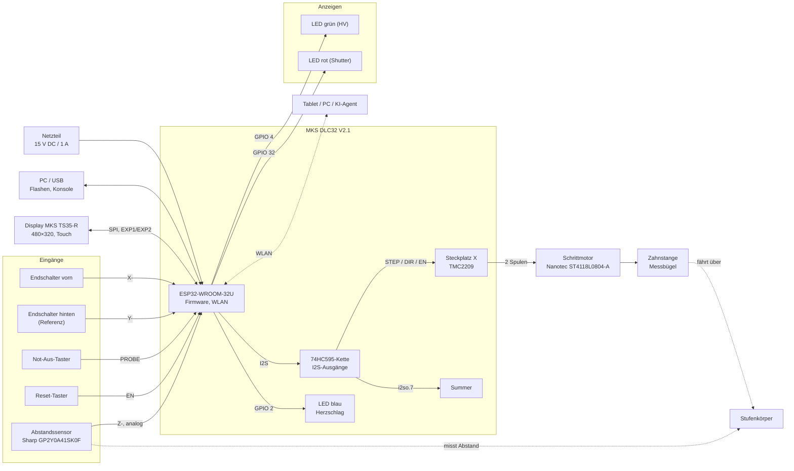

# Hardware-Dokumentation – Demoanlage ADD (Slim)

**Version:** 1.0 · **Stand:** 2026-11-07 · **Autor:** Norbert Walter
**Basis:** Pflichtenheft Demoanlage ADD Slim V1.7.10, Smoketest-Protokoll 0a, `src/config.h`

---

## Inhalt

1. [Einführung](#1-einführung)
2. [Sicherheitshinweise](#2-sicherheitshinweise)
3. [Technische Daten](#3-technische-daten)
4. [Funktionale Übersicht](#4-funktionale-übersicht)
5. [Mainboard und Display](#5-mainboard-und-display)
6. [Abstandssensor und Messkette](#6-abstandssensor-und-messkette)
7. [Motortreiber und Motor](#7-motortreiber-und-motor)
8. [Inbetriebnahme](#8-inbetriebnahme)
9. [Fehlersuche](#9-fehlersuche)
10. [Anhang](#10-anhang)

---

## 1. Einführung

### 1.1 Was die Demoanlage ist

Die Demoanlage ADD (Slim) ist ein **verkleinertes Modell (etwa 1:5) eines radiometrischen
Dickenmessers**, wie er in Walzwerken zur Dickenmessung von Bändern und Blechen eingesetzt wird
(Vorbild: Messsystem M50). Ein C-förmiger Messbügel fährt auf einer Linearachse über ein Messobjekt
und misst dessen Dicke.

Die radiometrische Messtechnik (Röntgenquelle, Hochspannung, Shutter) wird **nur nachgebildet**:

- Hochspannung und Shutter sind **LEDs** (grün = Hochspannung ein, rot = Shutter offen).
- Statt der Strahlung misst ein **optischer Infrarot-Abstandssensor** den Abstand zur Oberfläche
  des Messobjekts. Die Dicke ergibt sich aus dem Abstand zu einer Bezugsebene.

Die Anlage erzeugt keine ionisierende Strahlung und keine Hochspannung.

### 1.2 Wozu sie dient

Die Anlage dient der Präsentation des Konzepts **AI Device Description (ADD)**: Das Gerät beschreibt
sich selbst in einem maschinenlesbaren Dokument (`/add`), sodass ein KI-Agent

- die Anlage versteht und einem Benutzer erklärt,
- Fragen zu Bedienung, Funktion und Sicherheitslogik beantwortet,
- über die REST-API Messprogramme ausführt und eigene Anzeigeseiten erstellt,
- bei Fehlern (z. B. ausgekoppelte Zahnstange) die Diagnose unterstützt.

Zielgruppe sind Entwickler, technische Entscheider, Geschäftsführung und ausgewählte Kunden.

### 1.3 Hardware-Basis

Die gesamte Funktion läuft auf **einem Mikrocontroller**:

- Steuerboard **Makerbase MKS DLC32 V2.1** (ESP32) – ursprünglich ein Laser-/CNC-Controller
- Touch-Display **MKS TS35-R** (3,5", 480 × 320)
- Schrittmotortreiber **TMC2209** und Schrittmotor **Nanotec ST4118L0804-A** (NEMA 17)
- Abstandssensor **Sharp GP2Y0A41SK0F**
- Rahmen und Messbügel aus dem **3D-Druck**, Antrieb über Zahnstange

Bedient wird die Anlage über das Display, über WLAN mit dem Browser (IMS-Bedienoberfläche) oder
über die REST-API.

### 1.4 Mitgeltende Unterlagen

| Dokument | Inhalt |
|---|---|
| `docs/Pflichtenheft_Demoanlage_ADD_Slim_V1.7.md` | Anforderungen, Betriebsmodi, Sicherheitskonzept |
| `docs/CONTRACT.md` | Schnittstellen (REST-API, `/proc`, Firmware-Module) |
| `docs/Smoketest_Protokoll.md` | Hardwareprüfung mit Messwerten (Sprint 0a) |
| `src/config.h` | verbindliche Pinbelegung und Antriebsparameter |
| `docs/reference/ADD_Style_Guide_IMS_V1_0.md` | Gestaltung von Webseiten für die Anlage |

---

## 2. Sicherheitshinweise

> Die Demoanlage ist ein Vorführmodell. Sie hat **keine sicherheitsgerichtete Steuerung** im Sinne
> der Maschinenrichtlinie. Betrieb nur unter Aufsicht einer eingewiesenen Person.

### 2.1 Quetschgefahr

Der Messbügel wird von einem Schrittmotor über eine Zahnstange bewegt (bis 20 mm/s, Haltemoment
des Motors 50 Ncm).

- **Nicht in den Fahrbereich greifen**, solange die Anlage eingeschaltet ist – auch wenn die Achse
  steht. Sie kann jederzeit durch einen Befehl (Display, Browser, Skript, KI-Agent) anlaufen.
- Zwischen Messbügel und Endanschlägen, zwischen Zahnstange und Zahnrad und an der Schleppkette
  können Finger eingeklemmt werden.
- Haare, Schmuck und Kabel vom Fahrbereich fernhalten.
- Bei Vorführungen den Fahrbereich so aufstellen, dass Zuschauer ihn nicht erreichen.

### 2.2 Gefahr aus dem autonomen Betrieb

Die Anlage ist dafür gebaut, von **Software und KI-Agenten** gesteuert zu werden.

- Eine Fahrt kann **ohne Bedienhandlung vor Ort** beginnen (REST-API über WLAN, Python-Skripte,
  KI-Agent).
- Vor dem Start eines Skripts oder Agenten: Fahrbereich frei, Personen informiert, Not-Aus in
  Reichweite.
- Der Kommunikations-Watchdog stoppt die Achse nach 5 s ohne gültigen Befehl, sobald ein Client
  die Anlage über die REST-API bedient – das ersetzt keine Aufsicht.
- **Der Not-Aus wirkt in der Demoanlage nur über die Software.** Der Taster wird von der Firmware
  gelesen und stoppt Motor, Hochspannung und Shutter. Bei einem Firmwarefehler oder während eines
  Neustarts wirkt er nicht. Bei der realen Anlage übernimmt ein Relais diese Aufgabe in Hardware.
- In der Standardverdrahtung (Schließer, `estop_nc = false`) wird ein **Drahtbruch nicht erkannt**
  (Abschnitt 5.5).
- Im Notfall: **Stromversorgung trennen** (Netzteil ausstecken).

### 2.3 WLAN als Sicherheitsrisiko

- Die REST-API hat **keine Anmeldung**. Jeder, der im WLAN der Anlage (Access Point `ADD-Demo`) oder
  im verbundenen Heimnetz ist, kann die Achse fahren, die simulierte Hochspannung schalten und
  Parameter ändern.
- Das Passwort des Access Points ist in der Firmware fest hinterlegt und dokumentiert (Abschnitt
  8.4). Es schützt nur vor zufälligen Verbindungen.
- Die Anlage **nicht in Netze mit Internetzugang von außen** (Portfreigabe) und nicht in
  Firmen-Produktionsnetze einbinden.
- Die Router-Zugangsdaten (SSID, Passwort) werden im Flash der Anlage gespeichert. Vor der Weitergabe
  der Anlage löschen (leere SSID setzen, `REBOOT`).
- Bei Vorführungen auf fremden Veranstaltungen nur den eigenen Access Point verwenden.

### 2.4 Induktionsspannungen beim Verschieben von Hand

Ein Schrittmotor arbeitet als **Generator**, wenn seine Welle gedreht wird.

- Wird der Messbügel **von Hand schnell verschoben**, erzeugt der Motor eine Spannung, die über den
  Treiber auf die Versorgungsleitung des Mainboards zurückgespeist wird. Das kann **Motortreiber,
  Mainboard und ESP32 zerstören** – auch bei ausgeschalteter Anlage.
- Den Messbügel **nur langsam** von Hand bewegen.
- Besser: die Achse mit der Software fahren (`PARK`, `SERVICE`, Display) oder die Zahnstange
  auskoppeln, bevor der Bügel von Hand verschoben wird.
- Das Motorkabel **nie bei eingeschalteter Anlage** stecken oder ziehen.

### 2.5 Betriebsspannung und Anschluss

- Versorgung: **15 V DC**, mindestens 1 A, aus einem Netzteil mit Kurzschlussschutz.
- Das Mainboard ist für 12 V bis 24 V ausgelegt; **24 V nicht überschreiten**, der Motortreiber
  verträgt höchstens 28 V.
- **Polarität prüfen**, bevor die Versorgung angeschlossen wird. Verpolung kann das Board zerstören.
- Motortreiber, Display und Sensor **nur im spannungslosen Zustand** stecken oder ziehen (auch das
  USB-Kabel abziehen).
- Motortreiber **in der richtigen Ausrichtung** einsetzen (Abschnitt 7.2). Ein verdreht eingesetzter
  Treiber wird beim Einschalten zerstört.

### 2.6 Weitere Hinweise

- **Wärme:** Motortreiber und Motor werden im Betrieb warm bis heiß. Kühlkörper nicht berühren und
  nicht abdecken.
- **ESD:** Mainboard, Treiber und Sensor sind empfindlich gegen elektrostatische Entladung. Vor dem
  Anfassen erden, Bauteile an den Kanten halten.
- **Flashen:** Beim Aufspielen der Firmware und beim Neustart kann der Motor kurz zucken (Ausgänge
  sind bis zur Initialisierung undefiniert). Fahrbereich frei halten.
- **Infrarot-Sensor:** Der Sharp-Sensor arbeitet mit einer Infrarot-LED (kein Laser), ungefährlich
  für die Augen.
- **Keine Strahlung:** Die Bezeichnungen „HV“ und „Shutter“ beziehen sich auf das nachgebildete
  Vorbild. Es gibt keine Hochspannung über 24 V und keine Strahlenquelle.

---

## 3. Technische Daten

| Eigenschaft | Wert |
|---|---|
| Versorgung | 15 V DC, 1 A, extern über die Schleppkette |
| Steuerung | MKS DLC32 V2.1, ESP32-WROOM-32U, 2 Kerne, 240 MHz |
| Speicher | 520 kB SRAM; Flash 8 MB, davon genutzt 4 MB (App 2944 kB, Dateisystem 1088 kB, NVS 20 kB) |
| Display | MKS TS35-R, 3,5", 480 × 320, resistiver Touch |
| Kommunikation | WLAN 802.11 b/g/n: eigener Access Point (immer an) und optional Router; USB (CH340C) für Flashen und Konsole |
| Antrieb | Schrittmotor NEMA 17, 0,8 A, Treiber TMC2209, 1/16-Mikroschritt |
| Übertragung | Zahnstange, 40,77 mm je Motorumdrehung → 78,49 Schritte/mm, Auflösung 0,013 mm |
| Verfahrweg | 0 … 242 mm (Software), vorderer Endschalter bei 244,3 mm |
| Geschwindigkeit | 1 … 20 mm/s, Beschleunigung 500 mm/s² |
| Abstandssensor | Sharp GP2Y0A41SK0F, Infrarot-Triangulation, 40 … 300 mm (Firmware-Messbereich 35 … 300 mm) |
| Messobjekt | Stufenkörper, 6 Stufen à 20 mm, Abstände 65 … 40 mm, Dicke 5 … 30 mm |
| Regelzyklus | 1 ms (Zykluszeit, Jitter und STOP-Latenz jeweils ≤ 3 ms) |
| Anzeigen | LED grün (HV), LED rot (Shutter), LED blau (Herzschlag), Summer |
| Bedienelemente | Not-Aus-Taster, Reset-Taster, Touch-Display |
| Rahmen | 3D-Druck |

---

## 4. Funktionale Übersicht

### 4.1 Aufbau

Ein C-förmiger **Messbügel** sitzt auf einem Schlitten der Linearachse. Im oberen Ausleger blickt der
**Abstandssensor** senkrecht nach unten. Unter dem Bügel liegt fest der **Stufenkörper**. Fährt der
Bügel über die Stufen, ändert sich der Abstand zwischen Sensor und Oberfläche – daraus berechnet die
Firmware die Dicke.

Die Achse ist in drei Zonen geteilt (Maschinenkoordinaten, Nullpunkt auf der Parkseite):

| Zone | Bereich | Bedeutung |
|---|---|---|
| Parkzone | 0 … 20 mm | Parkposition 2 mm; Shutter immer geschlossen |
| Servicezone | > 20 … 60 mm | Serviceposition 40 mm; Shutter nur manuell |
| Messzone | > 60 … 242 mm | Messgut 105 … 225 mm, Messposition 155 mm; Shutter nur durch die Automatik |

```
 hinterer                                                                vorderer
 Endschalter                                                             Endschalter
  (Referenz)                                                             (244,3 mm)
    |◄── Park ──►|◄─ Service ─►|◄──────────────── Messzone ────────────────►|
    0           20            60      105                      225     242
                                       ┌───┐
                                   ┌───┘   └───┐        Stufenkörper
                               ┌───┘  (6 Stufen à 20 mm, Abstand 65 → 40 mm)
                           ────┘
```

*Abbildung 1 (folgt): Gesamtansicht der Anlage – `docs/images/hw_01_gesamt.jpg`*

### 4.2 Blockschaltbild



### 4.3 Komponenten

**Rahmen und Messbügel (3D-Druck).**
Grundrahmen, Schlitten und C-förmiger Messbügel sind im 3D-Druck gefertigt. Der Messbügel trägt im
oberen Ausleger den Abstandssensor; der untere Ausleger liegt unter dem Messgut. Neben dem Messgut
(bei 242 mm) sieht der Sensor den unteren Ausleger. Die Kabel zum Bügel laufen in einer
Schleppkette. Wird der Messbügel seitenverkehrt eingebaut, werden Drehrichtung und
Referenzschalter in der Firmware getauscht; die Zonen bleiben unverändert.

**Mainboard [MKS DLC32 V2.1](https://github.com/makerbase-mks/MKS-DLC32).**
Ein Laser-/CNC-Controller von Makerbase mit dem Modul
[ESP32-WROOM-32U](https://www.espressif.com/sites/default/files/documentation/esp32-wroom-32d_esp32-wroom-32u_datasheet_en.pdf)
(2 Kerne, 240 MHz, WLAN, externe Antenne), Steckplätzen für drei Schrittmotortreiber, Anschlüssen
für Endschalter, Taster und Display sowie einem USB-Seriell-Wandler CH340C. Die Ausgänge für
Schrittmotoren und Summer werden über eine Kette von Schieberegistern (74HC595) am I2S-Bus des ESP32
erzeugt. Die Anlage nutzt nur den Steckplatz X.

**Display [MKS TS35-R](https://robu.in/product/makerbase-ts35-ts35-r/).**
3,5"-TFT mit 480 × 320 Pixeln (Controller ST7796) und resistivem Touch (ADS7843E,
XPT2046-kompatibel). Es zeigt Zustand, Position, Messwert und Fehler und bietet Tasten für die
lokale Bedienung (Bedienvorrang vor der REST-API). Angesteuert über SPI mit der Bibliothek
[LovyanGFX](https://github.com/lovyan03/LovyanGFX).

**Abstandssensor [Sharp GP2Y0A41SK0F](https://www.pololu.com/product/2464)**
([Datenblatt](https://www.pololu.com/file/0J713/GP2Y0A41SK0F.pdf)).
Infrarot-Triangulationssensor für 4 … 30 cm, Versorgung 5 V, analoger Spannungsausgang, neuer
Messwert etwa alle 16,5 ms. Die Ausgangsspannung fällt nichtlinear mit dem Abstand; die Firmware
rechnet sie mit einer kalibrierten Kennlinie um (Kapitel 6).

**LEDs.**

| LED | Farbe | Bedeutung | Anschluss |
|---|---|---|---|
| HV | grün | simulierte Hochspannung eingeschaltet | GPIO 4, HIGH = an, 20 mA |
| Shutter | rot | simulierter Shutter offen | GPIO 32 (SPINDLE/TTL), HIGH = an, 20 mA |
| Herzschlag | blau | Firmware läuft (1 s an / 1 s aus) | GPIO 2, LED auf dem Board |

**Summer.**
Aktiver Summer auf dem Board (Ausgang i2so.7), feste Tonhöhe. Die Signale unterscheiden sich im
Rhythmus:

| Ereignis | Muster (ms an/aus/an) |
|---|---|
| Firmware gestartet | 100 / 100 / 300 (kurz – lang) |
| Neustart (REBOOT) | 300 / 100 / 100 (lang – kurz) |
| Display-Taste angenommen | 50 |
| Referenzfahrt fertig | 150 |
| Fehler | 3 × 150 |
| Not-Aus | 4000 (Dauerton) |

**Endschalter.**
Zwei mechanische Schalter begrenzen die Achse. Der **hintere** Schalter (Parkseite) ist der
**Referenzschalter** für die Referenzfahrt (INIT); die Achsposition 0 liegt 2 mm davor. Der
**vordere** Schalter liegt bei 244,3 mm und stoppt die Achse, falls sie über den Software-Verfahrweg
hinausfährt. Beide schalten gegen GND (betätigt = LOW).

**Not-Aus-Taster.**
Ein echter Not-Aus-Taster am Anschluss PROBE. Die Firmware stoppt bei Betätigung im nächsten
1-ms-Zyklus Motor, Hochspannung und Shutter und geht in den Fehlerzustand (Quittierung mit ACK
nötig). Er wirkt **nur über die Software** (Abschnitt 2.2).

**Reset-Taster.**
Löst einen Neustart des ESP32 aus. Nach dem Neustart sind Motor, HV und Shutter aus; die Achse muss
neu referenziert werden (INIT). Der Reset-Taster ist **kein** Not-Aus.

**Motortreiber [TMC2209](https://www.analog.com/en/products/tmc2209.html).**
Schrittmotortreiber im Stepstick-Format im Steckplatz X, betrieben im Standalone-Modus (STEP/DIR,
Mikroschritt per Jumper, Strom per Potentiometer). Leise (StealthChop), bis 2 A effektiv
(Kapitel 7).

**Motor [Nanotec ST4118L0804-A](https://nanotec.com/eu/en/products/366-st4118l0804-a).**
Zweiphasen-Hybridschrittmotor NEMA 17 (42 mm Flansch), 1,8° je Schritt (200 Schritte/U),
0,8 A je Wicklung, 9,3 Ω und 17 mH je Wicklung, Haltemoment 50 Ncm.

**Zahnstange.**
Ein Zahnrad auf der Motorwelle treibt eine Zahnstange an; 40,77 mm Weg je Umdrehung (gemessen). Die
Zahnstange kann ausgekoppelt werden – das wird zur Fehlersimulation genutzt (Positionsabweichung,
`MOTOR_FAULT`).

**Stufenkörper (Messobjekt).**
Ein Treppenkörper mit sechs Stufen à 20 mm Länge im Bereich 105 … 225 mm der Achse. Die Oberflächen
liegen 65, 60, 55, 50, 45 und 40 mm unter dem Sensor. Mit der Bezugsebene `base_dist` = 70 mm ergibt
sich die angezeigte Dicke = 70 mm − Abstand, also 5 … 30 mm. An den Kanten ändert sich der Messwert
stetig, bis der Messfleck wieder ganz auf einer Stufe liegt.

**Stromversorgung.**
Ein externes Netzteil 15 V DC / 1 A versorgt das Mainboard; das Board erzeugt daraus die
Logikspannungen. Netzkabel und USB-Kabel laufen durch die Schleppkette.

*Abbildung 2 (folgt): Messbügel mit Sensor über dem Stufenkörper – `docs/images/hw_02_messbuegel.jpg`*

---

## 5. Mainboard und Display

*Abbildung 3 (folgt): Mainboard mit allen Anschlüssen – `docs/images/hw_03_mainboard.jpg`*

Die Herstellerunterlagen zum Board (Anschlussplan, Schaltplan) stehen im Repository
[makerbase-mks/MKS-DLC32](https://github.com/makerbase-mks/MKS-DLC32), insbesondere der
[DLC32 wiring manual](https://github.com/makerbase-mks/MKS-DLC32/blob/main/doc/DLC32%20wiring%20manual.pdf).
Die verbindliche Pinbelegung der Anlage steht in `src/config.h`.

### 5.1 Anschlussübersicht

| Funktion | Anschluss am DLC32 | ESP32-Pin | Pegel / Bemerkung |
|---|---|---|---|
| Versorgung | DC-Eingang (12–24 V) | – | 15 V DC, Polarität beachten |
| PC | USB (CH340C) | GPIO 1/3 | Flashen 115200 Bd, Konsole |
| Display | EXP1 / EXP2 (Flachbandkabel) | SPI, siehe 5.2 | – |
| Endschalter vorn | X- | GPIO 36 | gegen GND, betätigt LOW |
| Endschalter hinten (Referenz) | Y- | GPIO 35 | gegen GND, betätigt LOW |
| Abstandssensor | Z- | GPIO 34 (ADC1_CH6) | analog 0 … 3,1 V; Board-Änderung nötig (Kapitel 6) |
| Not-Aus-Taster | PROBE | GPIO 22 | gegen GND, Pull-up auf dem Board, Pegel per `estop_nc` |
| LED rot (Shutter) | SPINDLE/TTL | GPIO 32 | HIGH = an, mit Vorwiderstand |
| LED grün (HV) | GPIO 4 | GPIO 4 | HIGH = an, mit Vorwiderstand |
| LED blau (Herzschlag) | auf dem Board | GPIO 2 | – |
| Motortreiber | Steckplatz X | über 74HC595 | Kapitel 7 |
| Schrittmotor | Motorstecker X | – | Kapitel 7 |
| Summer | auf dem Board | über 74HC595 (i2so.7) | aktiver Summer |
| Reset-Taster | Reset des ESP32 (EN) | EN | Neustart |

Die Eingänge GPIO 34, 35 und 36 sind beim ESP32 reine Eingänge ohne internen Pull-up; die nötigen
Pull-ups sitzen auf dem Board (außer am Sensoreingang, Kapitel 6).

### 5.2 Display MKS TS35-R

Das Display wird mit **zwei Flachbandkabeln** an die Buchsen **EXP1** und **EXP2** des Mainboards
angeschlossen (EXP1 an EXP1, EXP2 an EXP2; Kabel nicht vertauschen, Kodiernase beachten). Display
und Touch teilen sich den SPI-Bus (VSPI):

| Signal | ESP32-Pin | Bemerkung |
|---|---|---|
| SCK | GPIO 18 | Takt |
| MOSI | GPIO 23 | Daten zum Display |
| MISO | GPIO 19 | Daten vom Touch |
| DC | GPIO 33 | Daten/Befehl |
| CS (Display) | GPIO 25 | |
| RST | GPIO 27 | Display-Reset |
| BL | GPIO 5 | Hintergrundbeleuchtung |
| CS (Touch) | GPIO 26 | ADS7843E |

Einstellungen in der Firmware (Smoketest 6): Querformat, Farbreihenfolge RGB, nicht invertiert,
Touch um 180° gedreht (`offset_rotation` = 2), Touch-Kalibrierung in `config.h`.

### 5.3 Endschalter

- Mechanische Mikroschalter, als **Schließer gegen GND** angeschlossen (Signal und GND des
  Anschlusses). Betätigt = LOW, entprellt mit 5 ms.
- **Vorn** → Anschluss **X-** (GPIO 36), **hinten** → Anschluss **Y-** (GPIO 35).
- Der hintere Schalter ist der Referenzschalter. Wird der Messbügel seitenverkehrt eingebaut,
  werden Drehrichtung (`DIR_POSITIVE_HIGH`) und Referenzschalter in `config.h` getauscht.
- Prüfung: im Status des Displays oder mit `/proc` (`limit_fwd`, `limit_bwd`) bei Betätigung von Hand.

### 5.4 LEDs

Beide LEDs werden direkt vom ESP32 getrieben (HIGH = an) und brauchen einen **Vorwiderstand**
(ausgelegt auf 20 mA). Mehr Strom überlastet den GPIO. Die rote LED hängt am Anschluss
SPINDLE/TTL (GPIO 32), die grüne an GPIO 4.

### 5.5 Not-Aus-Taster

Der Not-Aus-Taster hängt am Anschluss **PROBE** (GPIO 22) gegen GND; der Pull-up sitzt auf dem
Board. Welche Kontaktart verwendet wird, stellt der Parameter `estop_nc` ein (REST-API `SET` oder
Einstellungsseite):

| `estop_nc` | Verdrahtung | Not-Aus bei | Drahtbruch |
|---|---|---|---|
| `false` (Standard) | Schließer gegen GND | LOW (Taster gedrückt) | **nicht erkannt** |
| `true` (empfohlen) | Öffner gegen GND | HIGH (Taster gedrückt oder Leitung unterbrochen) | erkannt |

Passt die Einstellung nicht zur Verdrahtung, zeigt die Anlage **Dauer-Not-Aus** – der Fehler ist
sicher und sofort sichtbar. Umschalten nur bei stehender Achse und HV aus. Solange `false` gilt,
zeigt das Display `ESTOP(NO)` als Warnung.

Derzeit ist ein Schließer eingebaut (`estop_nc = false`). Für Vorführungen wird ein Öffner mit
Drahtbrucherkennung empfohlen.

### 5.6 Reset-Taster

Der Reset-Taster startet den ESP32 neu. Nach dem Neustart:

- sind die Motortreiber gesperrt (Enable aktiv LOW, nach Boot HIGH), HV und Shutter aus,
- steht die Anlage im Zustand `SAFE_START`; erst INIT (Referenzfahrt) gibt die Achse frei,
- kann der Motor beim Neustart kurz zucken (bekannt, Ausgänge bis zur Initialisierung undefiniert).

### 5.7 Versorgung und USB

- Netzteil 15 V DC / 1 A an den DC-Eingang des Boards. Polarität vor dem Einschalten prüfen.
- Über **USB allein** läuft der ESP32 (Flashen, Konsole), aber der Motor hat keine Leistung. Zum
  Testen der Antriebe immer das Netzteil anschließen.
- Beide Kabel laufen durch die Schleppkette; auf Zugentlastung achten.

---

## 6. Abstandssensor und Messkette

### 6.1 Anschluss

| Sensorpin (von hinten gesehen, links → rechts) | Anschluss |
|---|---|
| Vcc (5 V) | 5 V |
| GND | GND |
| Vo (Ausgang) | Signal Z- (GPIO 34) |

### 6.2 Notwendige Beschaltung

Der Sensor arbeitet nur mit diesen Änderungen zuverlässig (Pflichtenheft V1.7.2, Smoketest 5):

| Änderung | Wo | Grund |
|---|---|---|
| **11 kΩ zwischen Vo und GND** | am Sensor angelötet | Der Ausgang (Emitterfolger) braucht eine Last; ohne sie bleibt der Eingang nach den ersten Messungen am Anschlag hängen. **Zwingend.** |
| **47 µF zwischen Vcc und GND** | am Sensor angelötet | Der Sensor zieht Strom in kurzen, hohen Pulsen; der Kondensator verhindert Spannungseinbrüche (Datenblatt: ≥ 10 µF) |
| **Pull-up R20 (4,7 kΩ) entfernt** | auf dem DLC32, Eingang Z- | Der Pull-up nach 3,3 V verfälscht die Sensorspannung |
| R23 (1 kΩ) bleibt | auf dem DLC32 | Serienwiderstand zum ADC-Eingang |

### 6.3 Messkette

1. Der ESP32 liest jede Millisekunde einen ADC-Wert (11 dB Dämpfung, eFuse-kalibriert,
   `analogReadMilliVolts`).
2. Alle 20 ms bildet die Firmware aus den Werten Median und Mittelwert.
3. Die Spannung wird mit der Kennlinie **Abstand = 168,8 · U^−1,398** (U in V, Abstand in mm) in
   den Abstand umgerechnet und mit einer Zweipunkt-Kalibrierung (Nah/Fern) korrigiert.
4. Dicke = `base_dist` (70 mm) − Abstand.

Kalibrierpunkte (Smoketest 0a, mit 11 kΩ Last):

| Achse | Stufe | Abstand (Soll) | Spannung (ESP) | Kennlinie |
|---|---|---|---|---|
| 115 mm | 1 | 65 mm | 1,972 V | 65,32 mm |
| 135 mm | 2 | 60 mm | 2,091 V | 60,20 mm |
| 155 mm | 3 | 55 mm | 2,236 V | 54,81 mm |
| 175 mm | 4 | 50 mm | 2,403 V | 49,55 mm |
| 195 mm | 5 | 45 mm | 2,588 V | 44,66 mm |
| 215 mm | 6 | 40 mm | 2,777 V | 40,48 mm |
| 242 mm | neben dem Messgut | unterer Ausleger | 0,933 V | ≈ 186 mm |

Die Streuung liegt bei höchstens 8,4 mV (≈ 0,34 mm).

**Hinweis:** Die ESP-Messwerte liegen etwa 235 mV über der mit einem Multimeter direkt am Sensor
gemessenen Spannung (konstanter Versatz des ADC). Für die Messung ist das ohne Bedeutung, weil
Kennlinie und Kalibrierung gegen die ESP-Werte ermittelt wurden. **Nach dem Tausch von Board,
ESP32 oder Sensor neu kalibrieren** (Seite „Kalibrierung“ der Weboberfläche).

---

## 7. Motortreiber und Motor

### 7.1 Ansteuerung über das Mainboard

Der ESP32 erzeugt die Signale STEP, DIR und ENABLE nicht direkt an GPIOs, sondern über die
74HC595-Kette am I2S-Bus (DATA GPIO 21, BCK GPIO 16, WS GPIO 17):

| Signal | I2S-Ausgang | Bemerkung |
|---|---|---|
| ENABLE (alle Treiber) | i2so.0 | aktiv LOW; nach dem Boot gesperrt |
| STEP X | i2so.1 | ein Puls = ein Mikroschritt |
| DIR X | i2so.2 | `DIR_POSITIVE_HIGH` = false: LOW = Richtung vorn (+mm) |

Die Bibliothek FastAccelStepper erzeugt die Schrittfolge mit Rampen. Die Verdrahtung zwischen
Schieberegister und Treiber-Steckplatz liegt auf dem Board – es sind keine Kabel nötig.

### 7.2 Motortreiber einsetzen

Der Treiber ist ein Modul im **Stepstick-Format** und wird in den **Steckplatz X** des DLC32
gesteckt.

1. Anlage **spannungslos** machen (Netzteil und USB abziehen).
2. Mikroschritt-Jumper unter dem Steckplatz setzen (Abschnitt 7.4).
3. **Ausrichtung prüfen:** Der Pin **EN** des Moduls muss auf der EN-Markierung des Steckplatzes
   sitzen, **GND/VM** des Moduls auf der Seite der Motorversorgung. Das Potentiometer zeigt bei den
   meisten Modulen in Richtung der EN-Seite – maßgeblich ist die Beschriftung auf Modul und Board.
4. Modul gerade einsetzen, kein Pin darf daneben stecken.
5. Kühlkörper aufkleben, falls nicht vorhanden; er darf keine Pins berühren.
6. Erst dann Strom einstellen (Abschnitt 7.5), danach den Motor anschließen.

> Ein verdreht eingesetzter Treiber wird beim Einschalten zerstört und kann das Board beschädigen.

*Abbildung 4 (folgt): Treiber im Steckplatz X mit Jumpern – `docs/images/hw_04_treiber.jpg`*

### 7.3 Motor anschließen

Der Motor wird am **Motorstecker X** des Boards angeschlossen (4-polig).

- Der Schrittmotor hat **zwei Spulen** (A und B) mit je zwei Anschlüssen. Die beiden Leitungen
  einer Spule müssen nebeneinander auf **1A/1B** bzw. **2A/2B** des Steckers liegen.
- Spulenpaare ohne Datenblatt finden: mit dem Ohmmeter zwischen zwei Leitungen messen. Zur selben
  Spule gehören die Paare mit **≈ 9,3 Ω**; zwischen verschiedenen Spulen ist kein Durchgang.
- Dreht der Motor falsch herum, entweder die Leitungen **einer** Spule tauschen oder
  `DIR_POSITIVE_HIGH` in `config.h` ändern (Standard der Anlage: Firmware-Einstellung).
- Ist ein Spulenpaar falsch kombiniert, brummt oder zittert der Motor, dreht aber nicht.
- **Motor nur im spannungslosen Zustand stecken oder ziehen.** Wird der Stecker im Betrieb gezogen,
  zerstört die Induktionsspannung den Treiber.

Daten des Motors [Nanotec ST4118L0804-A](https://nanotec.com/eu/en/products/366-st4118l0804-a)
([Baureihe ST4118](https://www.nanotec.com/fileadmin/files/Baureihenuebersichten/Schrittmotoren/ST4118.pdf)):

| Eigenschaft | Wert |
|---|---|
| Bauform | NEMA 17, Flansch 42 mm, bipolar, 2 Phasen |
| Schrittwinkel | 1,8° (200 Vollschritte je Umdrehung) |
| Nennstrom | 0,8 A je Wicklung |
| Wicklungswiderstand | 9,3 Ω |
| Induktivität | 17 mH |
| Haltemoment | 50 Ncm |

### 7.4 Treibertypen und Mikroschritt

Der Steckplatz nimmt alle gängigen Stepstick-Treiber auf. Die Anlage verwendet den **TMC2209**;
die anderen Typen sind als Ersatz möglich, wenn Mikroschritt und Strom passend eingestellt werden.

| Typ | Hersteller | Max. Strom | Mikroschritt | Eigenschaften |
|---|---|---|---|---|
| **TMC2209** (eingebaut) | Trinamic / ADI | 2 A eff. | 8, 16, 32, 64 per Jumper (intern 256 interpoliert) | sehr leise (StealthChop), UART-Konfiguration möglich, StallGuard |
| TMC2208 | Trinamic / ADI | 1,4 A eff. | 2, 4, 8, 16 per Jumper | sehr leise, UART möglich |
| TMC2226 | Trinamic / ADI | 2 A eff. | wie TMC2209 | Bauform wie TMC2209, bessere Kühlung |
| A4988 | Allegro | 1 A (ohne Kühlung), 2 A Spitze | 1 … 16 | einfach, laut, günstig |
| DRV8825 | TI | 1,5 A (ohne Kühlung), 2,2 A Spitze | 1 … 32 | laut, höhere Spannung |

**Die Firmware erwartet 1/16-Mikroschritt** (`MICROSTEPS` = 16 in `config.h`, 3200 Schritte je
Umdrehung, 78,49 Schritte/mm). Wird ein anderer Mikroschritt eingestellt, stimmen Wege und
Geschwindigkeiten nicht mehr – dann `MICROSTEPS` anpassen.

Jumper für **1/16** (MS1, MS2, MS3 unter dem Steckplatz; „1“ = Jumper gesteckt):

| Typ | MS1 | MS2 | MS3 |
|---|---|---|---|
| **TMC2209** (eingebaut) | 1 | 1 | – (nicht stecken) |
| TMC2226 | 1 | 1 | – (nicht stecken) |
| TMC2208 | 1 | 1 | – (nicht stecken) |
| A4988 | 1 | 1 | 1 |
| DRV8825 | 0 | 0 | 1 |

Weitere Einstellungen des TMC2209 im Standalone-Modus:

| MS1 | MS2 | Mikroschritt |
|---|---|---|
| 0 | 0 | 1/8 |
| 1 | 0 | 1/32 |
| 0 | 1 | 1/64 |
| 1 | 1 | **1/16** |

> Bei TMC-Treibern liegt auf der Position MS3 je nach Modul der UART-Pin (PDN/UART). Dort **keinen
> Jumper** stecken, sonst arbeitet der Treiber nicht im Standalone-Modus wie erwartet.

### 7.5 Motorstrom einstellen

Der Strom wird am Potentiometer des Treibermoduls über die Referenzspannung **Vref** eingestellt.

**Messen:**

1. Netzteil anschließen, Anlage einschalten. Motor kann angeschlossen bleiben, Achse muss nicht
   fahren.
2. Multimeter (Gleichspannung) mit Minus an **GND** des Boards, mit Plus an den Schleifer des
   Potentiometers (Metallkappe) bzw. den Vref-Messpunkt des Moduls.
3. Mit einem **isolierten Keramik- oder Kunststoffschraubendreher** drehen. Ein Abrutschen mit
   einem Metallschraubendreher kann den Treiber zerstören.

**Formeln** (Modulwerte; der Messwiderstand Rs kann je Hersteller abweichen – Beschreibung des
Moduls prüfen):

| Typ | Rs (typisch) | Strom aus Vref | Vref für 0,8 A |
|---|---|---|---|
| **TMC2209 / TMC2226** | 0,11 Ω | I_eff ≈ Vref / 1,41 (I_Spitze ≈ Vref) | **≈ 1,13 V** (0,8 A eff.) |
| TMC2208 | 0,11 Ω | I_eff ≈ Vref / 1,41 | ≈ 1,13 V |
| A4988 | 0,1 Ω (Pololu 0,068 Ω) | I_max = Vref / (8 · Rs) | 0,64 V (Pololu 0,44 V) |
| DRV8825 | 0,1 Ω | I_max = 2 · Vref | 0,40 V |

Beim TMC2209 dreht man **im Uhrzeigersinn** den Strom **herunter**, gegen den Uhrzeigersinn
herauf; zulässiger Bereich Vref 0,2 … 2,2 V (Werkseinstellung etwa 1,2 V).

Der Motor der Anlage ist mit **0,8 A** eingestellt und läuft damit ohne Schrittverlust von 1 bis
20 mm/s (Smoketest 4). Wird der Motor zu heiß (über etwa 70 °C), den Strom auf etwa 0,6 A
(Vref ≈ 0,85 V beim TMC2209) senken und die Fahrten erneut prüfen.

Datenblätter und Beschreibungen:
[TMC2209 (Analog Devices)](https://www.analog.com/en/products/tmc2209.html) ·
[TMC2209-Modul, Vref und Jumper (BIGTREETECH)](https://global.bttwiki.com/TMC2209.html)

### 7.6 Bekannte Eigenheiten

- **Resonanz bei 5 mm/s** (Geschwindigkeit der Referenzfahrt): hörbar, ohne Schrittverlust.
- **Zucken beim Neustart:** die I2S-Ausgänge sind bis zur Initialisierung undefiniert.
- Der Treiber wird nach jedem Boot gesperrt und erst von der Firmware freigegeben.

---

## 8. Inbetriebnahme

Die Reihenfolge entspricht dem Smoketest 0a (`docs/Smoketest_Protokoll.md`). Bei einer neuen oder
umgebauten Anlage die Schritte in dieser Reihenfolge ausführen.

### 8.1 Mechanik

1. Rahmen, Schlitten und Messbügel montieren, Achse von Hand **langsam** über den ganzen Weg
   schieben: läuft leicht, kein Klemmen (Abschnitt 2.4 beachten).
2. Zahnstange einkoppeln, Zahnflanken ohne Spiel und ohne Klemmen.
3. Stufenkörper unter dem Bügel befestigen (Achse 105 … 225 mm).
4. Endschalter so justieren, dass der Bügel sie vor dem mechanischen Anschlag betätigt.
5. Kabel in der Schleppkette verlegen, über den ganzen Weg ohne Zug.

### 8.2 Elektrik (spannungslos)

1. Board-Änderung für den Sensor prüfen (R20 entfernt, 11 kΩ und 47 µF am Sensor, Kapitel 6).
2. Mikroschritt-Jumper für 1/16 setzen, Treiber TMC2209 richtig herum in Steckplatz X (Kapitel 7).
3. Display mit beiden Flachbandkabeln anschließen (EXP1/EXP2).
4. Endschalter (X-, Y-), Sensor (Z-), Not-Aus (PROBE), LEDs und Reset-Taster anschließen.
5. Motor noch **nicht** anschließen.
6. Netzteil-Polarität und Spannung (15 V) mit dem Multimeter prüfen.

### 8.3 Erstes Einschalten

1. Netzteil einschalten: blaue LED blinkt (falls schon Firmware drauf ist), Display leuchtet.
2. **Vref** des Treibers auf ≈ 1,13 V einstellen (Abschnitt 7.5).
3. Ausschalten, Motor anschließen, wieder einschalten.

### 8.4 Firmware und WLAN

1. Firmware und Dateisystem vom Entwicklungsrechner aufspielen (USB). **Achtung: Der Motor kann
   sich dabei bewegen.**
   ```
   pio run -e firmware -t upload
   ```
   ```
   pio run -e firmware -t uploadfs
   ```
2. Nach dem Start: Summer kurz – lang, blaue LED blinkt, Display zeigt `SAFE_START`.
3. Mit Tablet oder PC das WLAN der Anlage verbinden:

   | Eigenschaft | Wert |
   |---|---|
   | SSID | `ADD-Demo` |
   | Passwort (Standard) | `adddemo1` |
   | Adresse | `http://192.168.4.1/` |

   Das Passwort ist in der Firmware fest hinterlegt. Siehe Sicherheitshinweise in Abschnitt 2.3.
4. Optional Router-Verbindung: auf der Seite „Einstellungen“ SSID und Passwort des Routers eintragen,
   speichern, Neustart. Danach ist die Anlage zusätzlich unter `http://add-demo.local` (bzw. der vom
   Router vergebenen IP-Adresse) erreichbar; der Access Point bleibt aktiv.

### 8.5 Funktionsprüfung

| # | Prüfung | Erwartung |
|---|---|---|
| 1 | Endschalter vorn und hinten von Hand betätigen | Seite „Status“ bzw. `/proc` zeigt den Schalter |
| 2 | Not-Aus drücken | Not-Aus-Signal (Dauerton 4 s), Zustand Fehler; nach Lösen ACK |
| 3 | Not-Aus-Verdrahtung prüfen | Schließer → `estop_nc = false`; Öffner → `estop_nc = true`. Falsche Einstellung = Dauer-Not-Aus |
| 4 | INIT (Referenzfahrt) | Achse fährt zum hinteren Schalter, Summer 150 ms, Zustand `READY` |
| 5 | SERVICE, dann PARK | Achse fährt nach 40 mm bzw. 2 mm; Richtung stimmt (positiv = Richtung vorn) |
| 6 | HV EIN, MESSEN | grüne LED an, Achse fährt nach 155 mm, rote LED an, Dicke ≈ 15 mm |
| 7 | STOP | Achse stoppt sofort, Shutter zu (rote LED aus) |
| 8 | TRAVERSE | Profilfahrt 80 → 240 mm, Stufen im Diagramm sichtbar |
| 9 | Reset-Taster | Neustart, Zustand `SAFE_START`, HV und Shutter aus |

### 8.6 Kalibrierung

Nach dem Tausch von Sensor, Board oder ESP32 und bei abweichenden Messwerten:
Seite „Kalibrierung“ der Weboberfläche – nahen Referenzpunkt anfahren und erfassen, fernen
Referenzpunkt anfahren und erfassen, Basis erfassen, speichern.

---

## 9. Fehlersuche

| Symptom | Mögliche Ursache | Abhilfe |
|---|---|---|
| Dauer-Not-Aus, obwohl der Taster nicht gedrückt ist | `estop_nc` passt nicht zur Verdrahtung; Leitung unterbrochen (bei Öffner) | Verdrahtung prüfen, `estop_nc` richtig setzen (Abschnitt 5.5) |
| Not-Aus wird bei abgezogener Leitung nicht erkannt | Schließer mit `estop_nc = false` (so vorgesehen) | Öffner einbauen und `estop_nc = true` setzen |
| Motor brummt oder zittert, dreht aber nicht | Spulenpaare falsch, Strom zu gering, Zahnstange klemmt | Spulen mit Ohmmeter prüfen, Vref prüfen, Mechanik prüfen |
| Motor dreht nicht, kein Geräusch | Treiber gesperrt (Zustand `SAFE_START`), Netzteil fehlt (nur USB), Treiber defekt | INIT ausführen, Netzteil anschließen, Treiber tauschen |
| Achse fährt in die falsche Richtung | Motorleitungen einer Spule vertauscht | `DIR_POSITIVE_HIGH` anpassen oder eine Spule umpolen |
| Wege stimmen nicht (z. B. halber oder doppelter Weg) | Mikroschritt-Jumper ≠ 1/16 | Jumper nach Abschnitt 7.4 setzen |
| Schrittverluste, Position weicht ab (`MOTOR_FAULT`) | Strom zu gering, Zahnstange ausgekoppelt, Mechanik schwergängig | Vref prüfen, Zahnstange einkoppeln, Achse prüfen |
| Treiber oder Motor sehr heiß | Strom zu hoch, keine Kühlung | Vref senken, Kühlkörper, Luftzirkulation |
| Abstand bleibt fest auf einem Wert | 11-kΩ-Last am Sensor fehlt | Beschaltung nach Abschnitt 6.2 prüfen |
| Messwerte springen stark | 47-µF-Kondensator fehlt, Kabel locker | Beschaltung und Stecker prüfen |
| Messwerte nach Tausch verschoben | ADC-Versatz des neuen ESP32/Sensors | neu kalibrieren (Abschnitt 8.6) |
| Display bleibt weiß/schwarz | Flachbandkabel vertauscht oder verdreht | EXP1/EXP2 prüfen |
| Touch trifft nicht | Touch-Kalibrierung oder Rotation | Werte in `config.h` prüfen (Smoketest 6) |
| WLAN `ADD-Demo` nicht sichtbar | Firmware startet nicht, Antenne nicht angeschlossen | Konsole über USB prüfen, Antennenkabel am Modul prüfen |
| Router-Verbindung kommt nicht zustande | falsche SSID/Passwort, Router außer Reichweite | Log (`/log`) prüfen; die Anlage versucht es alle 2 min erneut |
| Browser zeigt „Keine Verbindung“ | Tablet im falschen WLAN, Anlage aus | WLAN `ADD-Demo` wählen, `http://192.168.4.1/` |
| Kurzes Zucken beim Einschalten oder Reset | bekannt (I2S-Ausgänge undefiniert) | keine – Fahrbereich frei halten |

---

## 10. Anhang

### 10.1 Stückliste

| Pos. | Anzahl | Bezeichnung | Bemerkung |
|---|---|---|---|
| 1 | 1 | Steuerboard Makerbase MKS DLC32 V2.1 | R20 entfernt |
| 2 | 1 | Display MKS TS35-R mit 2 Flachbandkabeln | |
| 3 | 1 | Schrittmotortreiber TMC2209 (Stepstick) mit Kühlkörper | Steckplatz X, 1/16, 0,8 A |
| 4 | 1 | Schrittmotor Nanotec ST4118L0804-A | NEMA 17, 0,8 A |
| 5 | 1 | Zahnrad und Zahnstange | 40,77 mm/U |
| 6 | 1 | Abstandssensor Sharp GP2Y0A41SK0F mit Kabel (JST PH, 3-polig) | |
| 7 | 1 | Widerstand 11 kΩ | am Sensor, Vo–GND |
| 8 | 1 | Elektrolytkondensator 47 µF | am Sensor, Vcc–GND |
| 9 | 2 | Mikroschalter (Endschalter) | vorn, hinten |
| 10 | 1 | Not-Aus-Taster | derzeit Schließer |
| 11 | 1 | Reset-Taster | |
| 12 | 1 | LED grün mit Vorwiderstand | HV |
| 13 | 1 | LED rot mit Vorwiderstand | Shutter |
| 14 | 1 | Netzteil 15 V DC, ≥ 1 A | |
| 15 | 1 | Schleppkette | |
| 16 | 1 | Rahmen, Schlitten, Messbügel, Stufenkörper | 3D-Druck |
| 17 | 1 | WLAN-Antenne für ESP32-WROOM-32U | |

### 10.2 Pinbelegung (vollständig)

| Signal | ESP32 | Anschluss | Richtung | Bemerkung |
|---|---|---|---|---|
| Endschalter vorn | GPIO 36 | X- | Eingang | LOW = betätigt |
| Endschalter hinten | GPIO 35 | Y- | Eingang | LOW = betätigt, Referenz |
| Abstandssensor | GPIO 34 | Z- | Eingang analog | ADC1_CH6, 11 dB |
| Not-Aus | GPIO 22 | PROBE | Eingang | Pegel per `estop_nc` |
| LED blau (Herzschlag) | GPIO 2 | Board | Ausgang | HIGH = an |
| LED grün (HV) | GPIO 4 | – | Ausgang | HIGH = an |
| LED rot (Shutter) | GPIO 32 | SPINDLE/TTL | Ausgang | HIGH = an |
| I2S DATA | GPIO 21 | Board | Ausgang | 74HC595 |
| I2S BCK | GPIO 16 | Board | Ausgang | 74HC595 |
| I2S WS | GPIO 17 | Board | Ausgang | 74HC595 |
| Treiber ENABLE | i2so.0 | Steckplatz X | Ausgang | aktiv LOW |
| Treiber STEP | i2so.1 | Steckplatz X | Ausgang | |
| Treiber DIR | i2so.2 | Steckplatz X | Ausgang | |
| Summer | i2so.7 | Board | Ausgang | aktiver Summer |
| Display SCK / MOSI / MISO | GPIO 18 / 23 / 19 | EXP1/EXP2 | SPI | VSPI |
| Display DC / CS / RST / BL | GPIO 33 / 25 / 27 / 5 | EXP1/EXP2 | Ausgang | |
| Touch CS | GPIO 26 | EXP1/EXP2 | Ausgang | ADS7843E |

### 10.3 Links

| Komponente | Link |
|---|---|
| Mainboard MKS DLC32 | [GitHub makerbase-mks/MKS-DLC32](https://github.com/makerbase-mks/MKS-DLC32) · [Wiring manual (PDF)](https://github.com/makerbase-mks/MKS-DLC32/blob/main/doc/DLC32%20wiring%20manual.pdf) |
| ESP32-WROOM-32U | [Datenblatt Espressif](https://www.espressif.com/sites/default/files/documentation/esp32-wroom-32d_esp32-wroom-32u_datasheet_en.pdf) |
| Display MKS TS35-R | [Produktseite](https://robu.in/product/makerbase-ts35-ts35-r/) · [LovyanGFX](https://github.com/lovyan03/LovyanGFX) |
| Motortreiber TMC2209 | [Analog Devices](https://www.analog.com/en/products/tmc2209.html) · [Modulbeschreibung BIGTREETECH](https://global.bttwiki.com/TMC2209.html) |
| Motor Nanotec ST4118L0804-A | [Produktseite](https://nanotec.com/eu/en/products/366-st4118l0804-a) · [Baureihe ST4118 (PDF)](https://www.nanotec.com/fileadmin/files/Baureihenuebersichten/Schrittmotoren/ST4118.pdf) |
| Abstandssensor Sharp GP2Y0A41SK0F | [Pololu](https://www.pololu.com/product/2464) · [Datenblatt (PDF)](https://www.pololu.com/file/0J713/GP2Y0A41SK0F.pdf) |
| Schrittmotor-Bibliothek | [FastAccelStepper](https://github.com/gin66/FastAccelStepper) |

### 10.4 Offene Punkte

- Fotos ergänzen (`docs/images/hw_01` … `hw_04`).
- Anschluss des Reset-Tasters und der grünen LED (GPIO 4) am Board mit Foto dokumentieren.
- Gemessenen Vref-Wert des eingebauten TMC2209 eintragen.
- Not-Aus auf Öffner umbauen (`estop_nc = true`) und zusätzlich hart verdrahten (wirkt derzeit nur
  über die Software).

### 10.5 Änderungshistorie

| Version | Datum | Änderung |
|---|---|---|
| 1.0 | 2026-11-07 | Erste Ausgabe auf Basis von Pflichtenheft V1.7.10 und Smoketest 0a |
