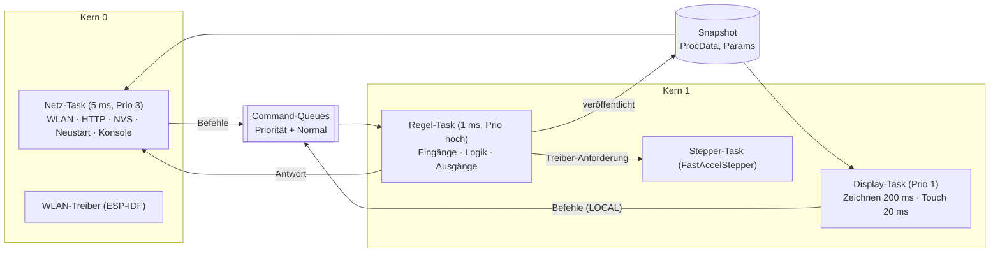
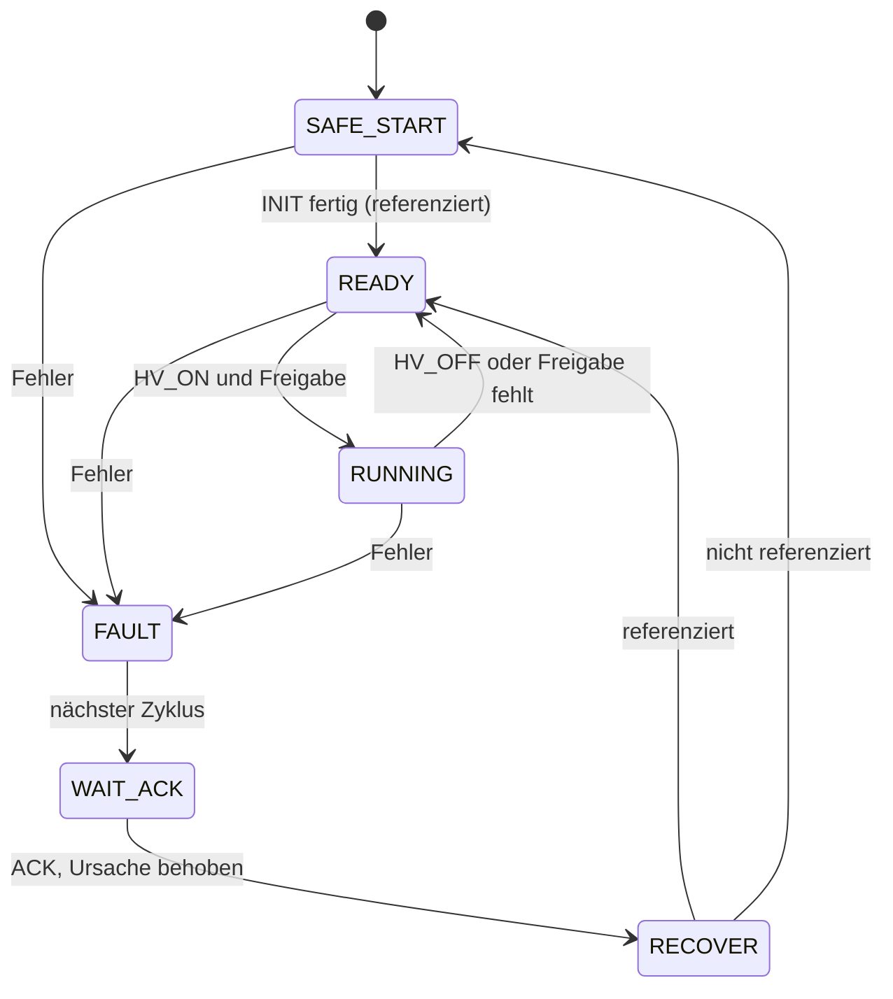
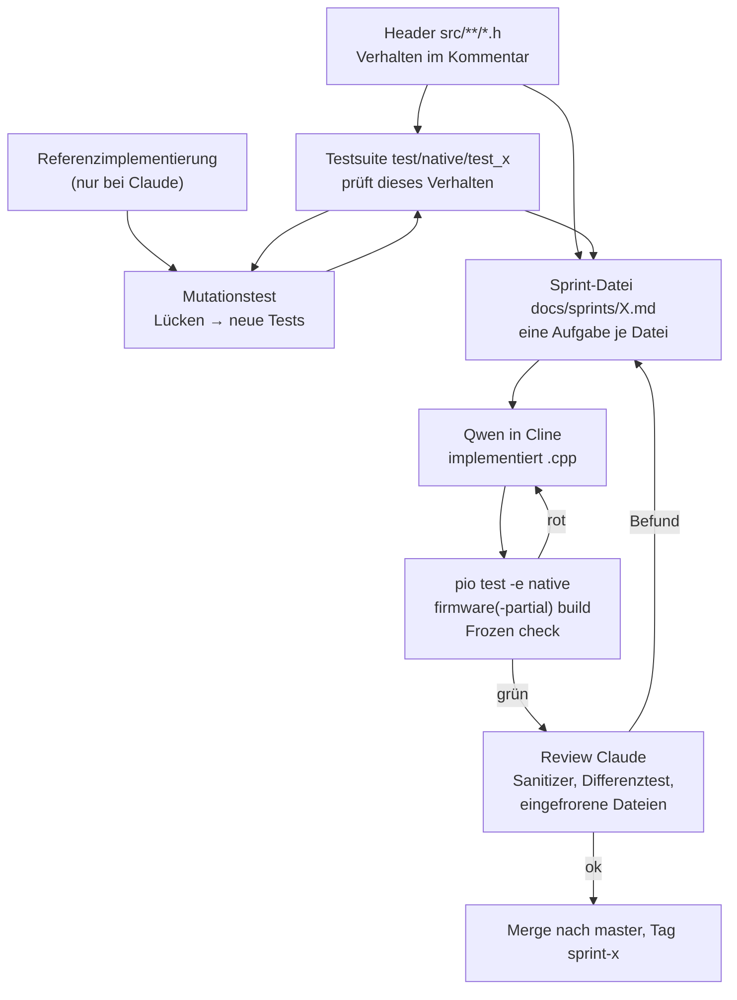
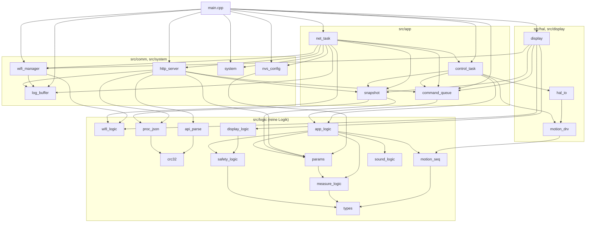
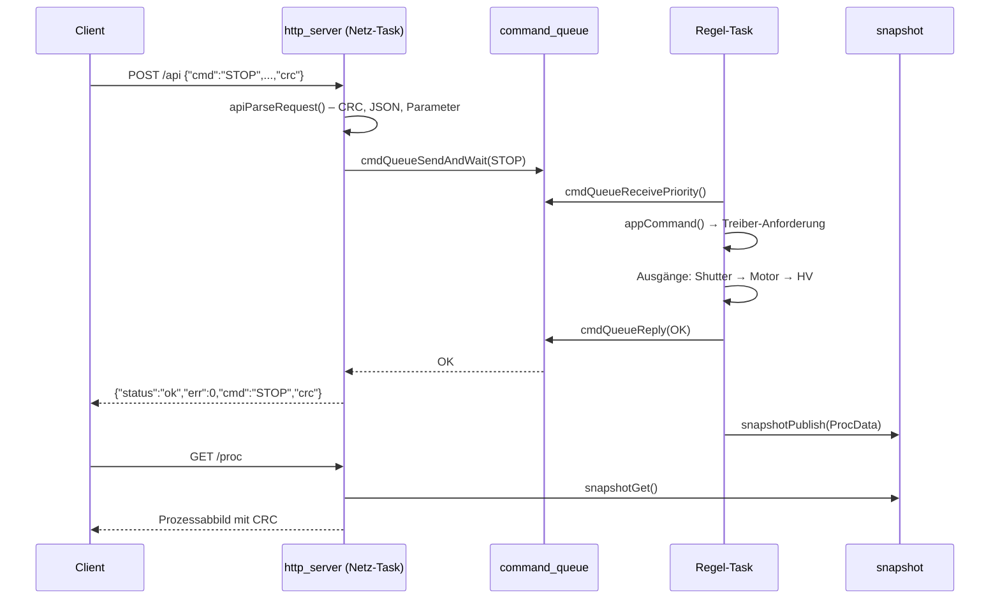

# Software-Dokumentation – Demoanlage ADD (Slim)

**Version:** 1.0 · **Stand:** 2026-11-07 · **Autor:** Norbert Walter
**Firmware:** `FW_VERSION` 1.0.0 · **Contract:** V1.5.28 · **Pflichtenheft:** V1.7.12
**Hardware:** siehe `docs/Hardware_Dokumentation_V1_0.md`

---

## Inhalt

1. [Einführung](#1-einführung)
2. [Verzeichnisse und Inhalte](#2-verzeichnisse-und-inhalte)
3. [Architektur zur Laufzeit](#3-architektur-zur-laufzeit)
4. [Zustände und Sicherheitslogik](#4-zustände-und-sicherheitslogik)
5. [Betriebsmodi](#5-betriebsmodi)
6. [Softwareentwicklung mit KI](#6-softwareentwicklung-mit-ki)
7. [Module, Funktionen und Abhängigkeiten](#7-module-funktionen-und-abhängigkeiten)
8. [PlatformIO-Befehle](#8-platformio-befehle)
9. [REST-API](#9-rest-api)
10. [HTTP-Endpunkte](#10-http-endpunkte)
11. [Serielle Konsole](#11-serielle-konsole)
12. [Bedienoberflächen und Kalibrierung](#12-bedienoberflächen-und-kalibrierung)
13. [ADD mit KI](#13-add-mit-ki)
14. [Tests und Werkzeuge](#14-tests-und-werkzeuge)
15. [Bekannte Einschränkungen und offene Punkte](#15-bekannte-einschränkungen-und-offene-punkte)
16. [Anhang](#16-anhang)

---

## 1. Einführung

### 1.1 Was die Software macht

Die Firmware steuert die Demoanlage ADD (Slim), ein 1:5-Modell eines radiometrischen
Dickenmessers. Sie läuft vollständig auf einem ESP32 (Board MKS DLC32 V2.1) und

- fährt die Linearachse mit dem Messbügel (Referenzfahrt, Positionieren, Profilfahrt),
- liest den Abstandssensor, rechnet den Abstand in eine Dicke um und bildet Statistiken,
- bildet die Sicherheitslogik eines radiometrischen Messgeräts nach (Hochspannung, Shutter,
  Not-Aus, Freigaben, Quittierung, Kommunikations-Watchdog),
- bietet mehrere Bedienwege (Tabelle unten),
- stellt ein **ADD-Dokument** (AI Device Description) bereit, mit dem sich die Anlage einer KI
  selbst beschreibt,
- betreibt WLAN als eigenen Access Point und optional zusätzlich im Heimnetz.

**Wie die Anlage gesteuert werden kann:**

| Weg | Verbindung | Was möglich ist | Kapitel |
|---|---|---|---|
| **Touch-Display** an der Anlage | lokal, ohne Netz | alle Grundfunktionen: INIT, HV, Messen, Profilfahrt, Park, Service, STOP, ACK (1 s halten); Anzeige von Zustand, Position, Messwert, IP-Adressen | 12.2 |
| **Weboberfläche** im Browser (Tablet, PC, Handy) | WLAN; die Seite nutzt die REST-API | alle Befehle, Einstellungen, Kalibrierung, Log, ADD-Validierung; vom Gerät geladen (`http://192.168.4.1/`) oder als lokale Datei | 12.1 |
| **Python-Skripte und KI-Agenten** | WLAN, REST-API (`/proc`, `/api`) | alle Befehle und Parameter, Messprogramme, Auswertung; Werkzeuge `add_client.py`, `stress_api.py` | 9, 13, 14.4 |
| **Python-Werkzeuge über USB** | serielle Verbindung über das USB-Kabel (CH340C, virtuelle COM-Schnittstelle, 115200 Bd) | Diagnose und Einrichtung: Version, Zustand, IP-Adressen, Router-WLAN einrichten, Neustart; Log mitlesen. **Keine Fahrbefehle.** Werkzeug `serial_cmd.py` oder `pio device monitor` | 11 |

Ethernet (LAN-Kabel) hat das Board nicht; Netzwerkzugriff gibt es nur über WLAN – entweder über
den eigenen Access Point der Anlage oder über ein Router-WLAN, in das sich die Anlage einbucht.

### 1.2 Grundsätzliche Aufteilung und warum

Die Firmware ist in vier Schichten geteilt:

| Schicht | Verzeichnis | Inhalt | Geprüft durch |
|---|---|---|---|
| **Reine Logik** | `src/logic/` | alle Entscheidungen: Sicherheit, Messkette, Ablaufsteuerung, Parameter, JSON, Parser, Display-Logik, Summer, WLAN-Zustandsautomat | native Tests auf dem PC (`pio test -e native`) |
| **Verbindung (Glue)** | `src/app/` | Tasks, Command-Queue, Snapshot, Startreihenfolge | native Tests mit Nachbildungen, Review |
| **Plattform** | `src/comm/`, `src/system/` | WLAN, HTTP-Server, Log, NVS, Neustart | native Tests mit Nachbildungen, Gerätetest |
| **Hardware** | `src/hal/`, `src/display/` | Ein-/Ausgänge, Schrittmotor, Display und Touch | Smoketest, Gerätetest |

Die Gründe:

1. **Testbar ohne Hardware.** Alles, was entscheidet, ist reines C++17 ohne Arduino, ESP-IDF
   oder FreeRTOS. Es läuft auf dem PC und wird dort mit 479 Tests geprüft – auch
   vollständige Abläufe mit einer simulierten Achse und ein zufälliger Invariantentest über
   60 000 Schritte. Fehler werden gefunden, bevor der Motor sich bewegt.
2. **Sicherheit durch klare Zuständigkeit.** Nur ein Task (der Regel-Task) ändert den
   Anlagenzustand. Alle anderen schicken Befehle in eine Warteschlange und lesen einen
   Schnappschuss. Es gibt keine weiteren gemeinsamen Variablen.
3. **Gut für die Arbeit mit einem lokalen KI-Modell.** Jede Datei hat einen eingefrorenen
   Header mit exakter Verhaltensbeschreibung und eigene Tests. Ein Modell mit 64k Kontext kann
   eine Datei nach der anderen umsetzen, ohne das ganze Projekt zu kennen (Kapitel 6).
4. **Austauschbare Hardware.** Die Hardware-Schicht ist dünn. Ein anderes Board oder ein anderer
   Treiber betrifft nur `src/hal/` und `src/config.h`.

### 1.3 Wesentliche Inhalte der Spezifikation

Die Spezifikation besteht aus dem Pflichtenheft (deutsch, für Menschen) und dem Contract
(englisch, verbindlich für Agenten). Die für die Software wesentlichen Punkte:

| Thema | Inhalt | Kapitel |
|---|---|---|
| Betriebsmodi | Referenzfahrt, Positionieren, stehende Messung, Profilfahrt, Park-/Serviceposition, Kalibrierung | 5 |
| Zonen der Achse | Parkzone 0–20 mm, Servicezone 20–60 mm, Messzone 60–242 mm in Maschinenkoordinaten | 5.1 |
| Sicherheitslogik | Zustandsautomat, HV-Freigabe (UND), Fehler mit Quittierung, Shutter-Regeln, Not-Aus, Watchdog, Bedienvorrang, STOP-Priorität | 4 |
| REST-API | `POST /api` mit JSON und CRC32-Rahmen, 17 Befehle, Fehlercodes, BUSY-Regel | 9 |
| Prozessabbild | `GET /proc`, ≤ 512 Byte, mit CRC32, alle 500 ms abgefragt | 10.2 |
| Parameter | 16 Schlüssel, Bereichsprüfung, Speicherung im Flash (NVS) nur im Stillstand | 9.5 |
| Messkette | 1 ADC-Wert je ms, Median-Mittel alle 20 ms, Kennlinie, IIR-Filter, Zweipunkt-Kalibrierung, Dicke = Bezugsebene − Abstand | 3.4 |
| Zeitverhalten | Regelzyklus 1 ms; Zykluszeit, Jitter und STOP-Latenz jeweils ≤ 3 ms | 3.3 |
| Display | 480 × 320, 7 Tasten, Fehlerbild mit ACK durch 1 s Halten, englisch | 12.2 |
| Weboberfläche | IMS-Bedienoberfläche, deutsch, eine Seite, auch lokal als Datei nutzbar | 12.1 |
| WLAN | Access Point immer an; Router-Verbindung optional mit Wiederholstrategie; mDNS `add-demo.local` | 10.7 |
| Summer | sechs Signalmuster mit Priorität | 3.6 |
| ADD | Gerätebeschreibung nach ADD Specification v1.0 unter `/add`, `/add.html`, `/llms.txt` | 13 |
| Simulierte Signale | Sicherheitskreis, Kühlwasserfluss und Kühlwassertemperatur werden per API gesetzt und als `SIM` gekennzeichnet | 4.2 |

---

## 2. Verzeichnisse und Inhalte

```
add-demo-slim/
├── platformio.ini            Build-Umgebungen, Bibliotheken, Ports
├── partitions.csv            Flash-Aufteilung (NVS, App, SPIFFS)
├── README.md                 Überblick, Sprint-Status
├── .clinerules               Regeln für den KI-Agenten (Cline)
├── .clineignore              Dateien, die der Agent nicht lesen soll
├── src/
│   ├── config.h              Pins, Zeiten, Antriebswerte (eingefroren)
│   ├── main.cpp              Startreihenfolge setup()
│   ├── partial_stub.cpp      Platzhalter für firmware-partial
│   ├── logic/                reine Logik (C++17, ohne Arduino)
│   ├── app/                  Tasks, Command-Queue, Snapshot
│   ├── comm/                 WLAN, HTTP-Server, Log-Puffer
│   ├── system/               NVS-Parameter, Neustart, Watchdog
│   ├── hal/                  Ein-/Ausgänge, Schrittmotortreiber
│   ├── display/              Display und Touch (LovyanGFX)
│   └── smoketest/            eigenständige Prüf-Firmware (Sprint 0a)
├── data/
│   └── www/                  Weboberfläche (index.html, settings.html, app.js, Schriften)
├── test/
│   ├── native/               22 Testsuiten für den PC, Nachbildungen (freertos_shim)
│   ├── embedded/             Gerätetest test_hardware
│   └── js/                   Tests der Weboberfläche (Node)
├── scripts/                  Python-Werkzeuge, Build-Prüfung
└── docs/
    ├── CONTRACT.md           verbindlicher Schnittstellenvertrag (englisch)
    ├── Pflichtenheft_…V1.7.md Anforderungen (deutsch)
    ├── Hardware_Dokumentation_V1_0.md
    ├── Software_Dokumentation_V1_0.md (dieses Dokument)
    ├── Smoketest_Protokoll.md
    ├── Sprint_Prompts_…V2.md Sprint-Plan V3, frühere Prompts
    ├── sprints/              Sprint-Dateien für Cline (eine Aufgabe je Abschnitt)
    ├── reviews/              Review-Protokolle je Sprint
    └── reference/            ADD Specification, Developer Guide, Style Guides
```

### 2.1 `src/` im Einzelnen

| Datei | Inhalt |
|---|---|
| `config.h` | Pinbelegung, Aktivpegel, I2S-Slots, Antriebswerte (78,49 Schritte/mm), Task-Prioritäten und -Kerne, Zeiten, `FW_VERSION`. Eingefroren seit Smoketest 0a |
| `main.cpp` | `setup()` in zehn Schritten (Kapitel 3.5); `loop()` wird nicht benutzt |
| `logic/types.*` | gemeinsame Typen (Zustände, Fehler, Befehle, `ProcData`) und Namensfunktionen |
| `logic/crc32.*` | CRC32 (IEEE/zlib) und CRC-Rahmen |
| `logic/safety_logic.*` | Sicherheitszustände, HV-Freigabe, Fehlerursache, Befehlsfilter, Watchdog |
| `logic/measure_logic.*` | Kennlinie, Median-Mittel, IIR, Kalibrierung, Dicke, Stabilität, Statistik |
| `logic/motion_seq.*` | nicht blockierende Ablaufsteuerung der Achse (Referenzfahrt, Fahrt, Profil, Messung) |
| `logic/params.*` | Parameter, Standardwerte, Bereiche, JSON für `GET_CONFIG` |
| `logic/sound_logic.*` | Summer-Muster und Prioritäten |
| `logic/wifi_logic.*` | Zustandsautomat der Router-Verbindung (3 Versuche, 2 min Pause) |
| `logic/app_logic.*` | Anwendungslogik: verbindet alle Logikmodule, ein Aufruf je Regelzyklus |
| `logic/proc_json.*` | `/proc`- und Antwort-JSON mit CRC |
| `logic/api_parse.*` | Parser für `/api`-Anfragen mit CRC-Prüfung |
| `logic/display_logic.*` | Bildschirmmodus, ACK-Bedingungen, Haltedauer der ACK-Taste |
| `app/command_queue.*` | Prioritäts- und Normal-Warteschlange, Überlauf-Latch, Antworten |
| `app/snapshot.*` | Kopie des Prozessabbilds und der Parameter für andere Tasks; Anforderungen (Speichern, Neustart) |
| `app/control_task.*` | Regel-Task (1 ms, Kern 1), Zeitmessung `CycleStats`, `CycleDiag` |
| `app/net_task.*` | Netz-Task (5 ms, Kern 0): WLAN, HTTP, NVS, Neustart, serielle Konsole, Diagnose-Logzeilen |
| `comm/http_server.*` | alle HTTP-Endpunkte, CORS, Trennen wartender Verbindungen |
| `comm/wifi_manager.*` | Access Point, Router-Verbindung, mDNS |
| `comm/log_buffer.*` | Ringpuffer der letzten 20 Logzeilen, Ausgabe auch seriell |
| `system/nvs_config.*` | Parameter im Flash (Namespace `add_demo`, Schema-Version 4) |
| `system/system.*` | Task-Watchdog (10 s), Neustart |
| `hal/hal_io.*` | Endschalter, Not-Aus (Pegel per `estop_nc`), ADC, LEDs, Summer |
| `hal/motion_drv.*` | FastAccelStepper mit I2S-Multiplexer, setzt Treiber-Anforderungen um |
| `display/display.*`, `lgfx_config.h` | Display-Task, Zeichnen, Touch |
| `smoketest/smoketest.cpp` | Prüf-Firmware mit eigener Konsole (Kapitel 14.3) |

### 2.2 `data/`

Inhalt des Dateisystems (SPIFFS), aufgespielt mit `pio run -e firmware -t uploadfs`:

| Datei | Inhalt |
|---|---|
| `www/index.html` | IMS-Bedienoberfläche (eine Seite, ca. 105 kB) |
| `www/settings.html` | Weiterleitung auf `/#settings` |
| `www/app.js` | ADDAPP: Protokoll- und Regelfunktionen (CRC, Rahmen, Tastenregeln, Parameterprüfung) |
| `www/font-*.woff2`, `LICENCE-ubuntu-font.txt` | Schriften Ubuntu und Ubuntu Mono |
| `add.json` | ADD-Dokument – **folgt mit Sprint D1** |
| `doc.html` | Dokumentationsseite für `/doc`: Kurzbeschreibung, Endpunkte, Links zur Dokumentation auf GitHub |

### 2.3 `test/`, `scripts/`, `docs/`

Siehe Kapitel 14 (Tests und Werkzeuge) und Kapitel 6 (Sprint-Dateien, Reviews).

---

## 3. Architektur zur Laufzeit

### 3.1 Tasks und Kerne



| Task | Kern | Priorität | Takt | Aufgabe |
|---|---|---|---|---|
| Regel-Task | 1 | `configMAX_PRIORITIES − 2` | 1 ms | Eingänge lesen, Logik, Ausgänge setzen, Prozessabbild veröffentlichen |
| Stepper-Task | 1 | hoch (Bibliothek) | 4 ms | Schrittpulse über den I2S-Multiplexer |
| Display-Task | 1 | 1 | 200 ms / 20 ms | Display zeichnen, Touch abfragen |
| Netz-Task | 0 | 3 | 5 ms | Konsole, WLAN, HTTP, NVS speichern, Neustart |

**Grundsatz „ein Schreiber“:** Nur der Regel-Task ändert den Anlagenzustand. Die anderen Tasks
kommunizieren ausschließlich über

- die **Command-Queues** (Befehle hin, Antwort zurück) und
- den **Snapshot** (Kopie des Prozessabbilds und der Parameter unter einem Spinlock).

### 3.2 Ein Regelzyklus

Reihenfolge in jedem 1-ms-Zyklus (`control_task.cpp`):

1. Eingänge lesen (Endschalter, Not-Aus, Treiberposition); **ein** ADC-Wert je Zyklus; alle
   20 ms `appMeasure()` mit dem Median-Mittel der gesammelten Werte.
2. `appTick()`: Ablaufsteuerung, Ereignisse, Sicherheitsprüfung, Not-Halt, Statistik,
   Shutter-Automatik, Watchdog, Bedienvorrang.
3. a) **alle** anstehenden Prioritätsbefehle (STOP, HV_OFF, SHUTTER_CLOSE; höchstens 7)
   b) wenn noch keine Treiber-Anforderung vorliegt: höchstens **ein** normaler Befehl.
4. Ausgänge in fester Reihenfolge: **Shutter → Motor → HV-LED**.
5. Antworten an wartende Aufrufer – erst nach den Ausgängen. `OK` heißt daher: Ausgänge
   dieses Zyklus sind schon gesetzt.
6. Prozessabbild veröffentlichen (`appFillProc()` → `snapshotPublish()`).
7. Zeitmessung (`CycleStats`).

### 3.3 Zeitverhalten

| Größe | Bedeutung | Grenze |
|---|---|---|
| `cycle_max_us` | längste Rechenzeit eines Zyklus (Schritte 1–6) | ≤ 3000 µs |
| `period_max_us` | längster Abstand zweier Zyklusstarts (Jitter) | ≤ 3000 µs |
| `prio_lat_max_us` | Prioritätsbefehl: Eintrag in die Queue → Ausgänge gesetzt | ≤ 3000 µs |
| `overruns` | Zyklen mit Rechenzeit > 1 ms | nur Information (gemessen ≈ 0,05 %) |

Die Werte sind Maxima seit `boot: ready` und stehen in der Antwort auf `GET_STATE`. Nachgewiesen
mit `stress_api.py` (Flood, Parallel, Latenz bei fahrender Achse, 10-min-Dauertest mit Weblast;
gemessen max. 2,22 / 2,41 / 1,73 ms). Der Netz-Task protokolliert lange Zyklen als
`ctrl: cycle … us, period … us (adc …, tick …, cmd …, out …, pub …)`.

### 3.4 Messkette

1. 1 ADC-Wert je ms (GPIO 34, 11 dB, `analogReadMilliVolts`), bis zu 16 Werte.
2. Alle 20 ms: sortieren, 4 kleinste und 4 größte verwerfen, Mittelwert.
3. Kennlinie: `dist_raw = 168,8 · U^−1,398` (U in V, Ergebnis in mm).
4. Außerhalb 35 … 300 mm: `in_range = false`, Filter zurückgesetzt, Dicke 0.
5. IIR-Filter (α = 0,8).
6. Zweipunkt-Kalibrierung (`calib_near/far_raw` → `calib_near/far_ref`).
7. `thick = max(0, base_dist − dist)`; `on_material = thick > edge_threshold`.
8. `valid` nur bei offenem Shutter (simuliert: ohne Strahlung keine Messung).
9. Statistik (`avg`, `n`) über gültige Werte auf dem Messgut während der Erfassung.

### 3.5 Startreihenfolge (`main.cpp`)

1. `systemInit()` – Task-Watchdog
2. `SPIFFS.begin(true)` – bei Fehler formatieren
3. `nvsLoadParams()` – Parameter aus dem Flash (sonst Standardwerte)
4. `cmdQueueInit()`
5. `controlTaskStart()` – Regel-Task, Treiber gesperrt
6. `displayStart()`
7. `wifiInit()` – Access Point, ggf. Router
8. `httpServerInit()`
9. `netTaskStart()`
10. Log `boot: ready, FW 1.0.0`, Summer kurz – lang

Schlägt ein Schritt fehl, läuft das Gerät weiter; `/log` zeigt, was fehlte.

### 3.6 Summer

| Signal | Muster (ms) | Wann |
|---|---|---|
| `BOOT` | 100 / 100 / 300 | erster Regelzyklus nach dem Start |
| `REBOOT` | 300 / 100 / 100 | angenommener REBOOT |
| `CLICK` | 50 | Display-Befehl angenommen |
| `HOMED` | 150 | Referenzfahrt fertig |
| `FAULT` | 3 × 150 | Fehler (außer Not-Aus) |
| `ESTOP` | 4000 | Not-Aus (einmalig) |

Ein Signal niedrigerer Priorität unterbricht nie ein höheres (ESTOP > FAULT > REBOOT > BOOT >
HOMED > CLICK).

### 3.7 Speichern im Flash

Parameter werden im **Netz-Task** gespeichert, nie im Regelzyklus. Weil ein Flash-Schreibvorgang
beide Kerne für einige 10 ms anhält, wird erst gespeichert, wenn **die Achse steht und die HV aus
ist** (Log `nvs: save deferred until axis idle and HV off`). Die Werte gelten ab dem `SET` sofort
im RAM. Vor einem Neustart wird ein offener Speicherauftrag noch ausgeführt. Sicherheitsflags
(`interlock`, `cooling_flow`, `temp`) werden nie gespeichert.

---

## 4. Zustände und Sicherheitslogik

> Die Sicherheitslogik ist eine **Nachbildung** für die Demonstration und keine
> Sicherheitsfunktion nach EN ISO 13849 / IEC 62061. HV und Shutter sind LEDs.

### 4.1 Zustandsautomat



| Zustand | Bedeutung | HV | Shutter |
|---|---|---|---|
| `SAFE_START` | nach dem Start oder ohne gültige Referenz; INIT nötig | aus | zu |
| `READY` | referenziert, bereit | aus | zu |
| `RUNNING` | Hochspannung ein | **ein** | darf offen sein |
| `FAULT` | Fehler erkannt (ein Zyklus) | aus | zu |
| `WAIT_ACK` | wartet auf Quittierung | aus | zu |
| `RECOVER` | ACK angenommen (ein Zyklus) | aus | zu |

**Kein automatischer Wiederanlauf:** Nach ACK bleiben HV und Shutter aus. Ein Not-Halt während
einer Fahrt löscht die Referenz; dann ist wieder INIT nötig.

### 4.2 Bedingungen

- **HV-Freigabe (UND):** `interlock` ∧ `cooling_flow` ∧ `temp ≤ 30,0 °C` ∧ kein Not-Aus.
- **HV-Abfall** (eine Bedingung fehlt): RUNNING → READY, Shutter zu, **kein Fehler, kein ACK**.
- **Fehler** (→ FAULT → WAIT_ACK, ACK nötig), Priorität der gemeldeten Ursache
  ESTOP > TEMP_HIGH > MOTOR_FAULT > COMM_TIMEOUT:

| Code | Name | Ursache | Abhilfe |
|---|---|---|---|
| 1 | `ESTOP` | Not-Aus gedrückt oder Leitung unterbrochen (bei Öffner) | Not-Aus lösen, ACK |
| 2 | `TEMP_HIGH` | simulierte Kühlwassertemperatur > 32,0 °C | `temp` ≤ 32 setzen, ACK |
| 3 | `COMM_TIMEOUT` | Fernbedienung aktiv und > 5 s kein gültiges `/api`-Paket | ACK, Client prüfen |
| 4 | `MOTOR_FAULT` | Endschalter unerwartet während einer Fahrt | Achse und Endschalter prüfen, ACK, INIT |
| 5 | `HOMING_FAILED` | Referenzfahrt > 70 s oder vorderer Schalter während der Referenzfahrt | Referenzschalter prüfen, ACK, INIT |

Die simulierten Signale `interlock`, `cooling_flow` und `temp` werden mit `SET` gesetzt. Nach
jedem Start gilt `interlock = true`, `cooling_flow = true`, `temp = 18,0 °C`.

### 4.3 Shutter

| Regel | Inhalt |
|---|---|
| Öffnen allgemein | nur in RUNNING und außerhalb der Parkzone (pos > 20 mm) |
| manuell (`SHUTTER_OPEN`) | nur in der Servicezone (20 < pos ≤ 60 mm), z. B. zur Prüfung der Quelle |
| automatisch | nur in der Messzone (pos > 60 mm) während eines Messprogramms (MEASURE, TRAVERSE) |
| schließt immer | HV aus, Fehler, Einfahrt in die Parkzone, `SHUTTER_CLOSE` |
| schließt zusätzlich (automatisch geöffnet) | `STOP` (im selben Zyklus), Einfahrt in die Servicezone, nach der Haltezeit `shutter_hold` (Standard 3 s) ohne Messprogramm |

Die Haltezeit erlaubt eine fortlaufende Hin-und-her-Profilfahrt: Schickt der Client den nächsten
`START_TRAVERSE` innerhalb der Haltezeit, bleibt der Shutter offen (schont das Vorbild).

### 4.4 Not-Aus

- Eingang PROBE (GPIO 22), Aktivierung sofort, Lösen entprellt.
- Kontaktart per Parameter `estop_nc`: `false` = Schließer (Standard, keine Drahtbrucherkennung),
  `true` = Öffner mit Drahtbrucherkennung. Eine falsche Einstellung zeigt Dauer-Not-Aus.
- Wirkung: Motor Not-Halt, HV und Shutter aus im selben Zyklus (≤ 2 ms).
- **Nur Software** – bei der realen Anlage übernimmt ein Relais diese Aufgabe.

### 4.5 Kommunikations-Watchdog

- **Scharf**, wenn `INIT`, `MOVE`, `PARK`, `SERVICE`, `START_*` oder `HV_ON` **über die API**
  angenommen wurde (`safety.comm_armed = true`).
- **Unscharf**, wenn die Achse steht und die HV aus ist, oder bei Bedienung am Display.
- Scharf und > 5 s kein gültiges `/api`-Paket → Fehler `COMM_TIMEOUT`.
- Clients halten ihn mit `GET_STATE` (mindestens alle 4 s, empfohlen 1 s) am Leben. `GET /proc`
  zählt **nicht**.

### 4.6 Bedienvorrang (LOCAL)

Die Person an der Anlage soll Vorrang vor Fernbedienung haben können:

- Mit `LOCAL_HOLD_MS > 0` (`config.h`) setzt jeder Display-Befehl `local = true`. Dann lehnt die
  API Startbefehle (`INIT, MOVE, PARK, SERVICE, START_*, HV_ON, SHUTTER_OPEN, CALIB, ACK, REBOOT`)
  mit `LOCAL_CONTROL (−10)` ab. `STOP`, `HV_OFF`, `SHUTTER_CLOSE`, `SET`, `GET_*` bleiben
  erlaubt.
- Ende: Achse steht, HV aus und Haltezeit seit dem letzten Display-Befehl abgelaufen.
- **Standard der Demoanlage: `LOCAL_HOLD_MS = 0`** – Display und API sind gleichberechtigt; ein
  Display-Befehl macht nur den Watchdog unscharf.

### 4.7 STOP-Priorität

`STOP`, `HV_OFF` und `SHUTTER_CLOSE` gehen in eine eigene Prioritäts-Warteschlange (Länge 4).
Ist sie voll, werden sie in einem Latch gespeichert (gleiche Anforderungen fallen zusammen, nichts
geht verloren). Der Regel-Task führt **alle** anstehenden Prioritätsbefehle im nächsten Zyklus
aus – auch wenn gerade ein anderer Befehl eine Treiber-Anforderung erzeugt hat. Ein STOP wartet
nie hinter anderen Befehlen.

| Abschnitt der Reaktionskette | Ziel |
|---|---|
| Eintrag in die Queue → Ausgänge gesetzt (`prio_lat_max_us`) | ≤ 3 ms |
| API-Client → Antwort (inkl. WLAN) | < 150 ms |
| Display-STOP → Eintrag in die Queue | ≤ 20 ms |
| STOP → Achse steht | < 1 s (Bremsrampe) |

---

## 5. Betriebsmodi

### 5.1 Zonen und Positionen

| Zone / Position | Bereich | Bedeutung |
|---|---|---|
| Parkzone | 0 … 20 mm | Shutter immer zu; Parkposition 2 mm (`PARK`) |
| Servicezone | > 20 … 60 mm | Shutter nur manuell; Serviceposition `maint_pos` 40 mm (`SERVICE`) |
| Messzone | > 60 … 242 mm | Shutter nur durch die Automatik; alle Mess- und Profilpositionen |
| Messgut | 105 … 225 mm | sechs Stufen à 20 mm, Stufenmitten 115, 135 … 215 mm, Dicke 5 … 30 mm |
| Messposition | 155 mm | Mitte Stufe 3, Dicke 15 mm (`measure_pos`) |
| Profilfahrt | 80 → 240 mm | Standard für `START_TRAVERSE` |

Die Zonen sind feste Konstanten in Maschinenkoordinaten (Nullpunkt auf der Parkseite) und nicht
über die API änderbar.

### 5.2 Übersicht

| Modus | Befehl | Zustand | Ablauf | Ende |
|---|---|---|---|---|
| Referenzfahrt | `INIT` | SAFE_START, READY | mit 5 mm/s zum hinteren Schalter, 2 mm frei fahren, Nullpunkt setzen | `READY`, `motion.homed = true`, Summer 150 ms |
| Positionieren | `MOVE pos [speed]` | READY, RUNNING | absolute Fahrt 0 … 242 mm, 1 … 20 mm/s | `motion.state = idle` |
| Parken | `PARK` | READY, RUNNING | Fahrt auf 2 mm mit 10 mm/s; Shutter schließt beim Einfahren | idle |
| Service | `SERVICE` | READY, RUNNING | Fahrt auf `maint_pos` | idle |
| Stehende Messung | `START_MEASURE [pos]` | RUNNING | Fahrt auf pos (> 60 mm), Shutter öffnet, Messung bis `STOP` | `STOP` |
| Profilfahrt | `START_TRAVERSE [start end speed]` | RUNNING | Anfahrt auf start mit 10 mm/s, Fahrt nach end mit speed, Messung unterwegs, bleibt am Ende stehen | `motion.mode = none` |
| Kalibrierung | `CALIB action` | SAFE_START, READY, RUNNING | Kapitel 12.3 | sofort |

Alle Bewegungen laufen **asynchron**: `OK` heißt „angenommen und gestartet“, das Ende sieht man in
`/proc` (`motion.state`, `motion.mode`, `state`).

### 5.3 Fortlaufende Profilfahrt

Für ein fortlaufendes Hin-und-her-Profil schickt der Client nach dem Ende eines Laufs
(`motion.mode` wieder `none`) innerhalb von `shutter_hold` (3 s) den nächsten `START_TRAVERSE` mit
vertauschtem Start und Ende. Der Shutter bleibt dabei offen. Ein Beispiel steht in Kapitel 13.4.

---

## 6. Softwareentwicklung mit KI

### 6.1 Rollen

| Rolle | Wer | Aufgaben |
|---|---|---|
| Auftraggeber, Entscheider | Norbert Walter | Anforderungen, Entscheidungen bei Konflikten, Hardware, Flashen, Gerätetests, Commit, Merge, Push |
| Architekt, Reviewer | Claude (Anthropic, Cloud) | Contract, Header, Tests, Nachbildungen, Referenzimplementierung (außerhalb des Repos), Sprint-Dateien, Mutationstests, Reviews, Dokumentation |
| Entwickler | Qwen3.6-35B-A3B (lokal, Cline in code-server, 64k Kontext) | implementiert die `.cpp`-Dateien und die Web-Seiten nach Header und Tests |

### 6.2 Grundidee: Verträge und Tests zuerst

Die Denkarbeit steckt in **eingefrorenen Verträgen**:

- `docs/CONTRACT.md` – Schnittstellen und Verhalten,
- **Header** `src/**/*.h` – jede Funktion mit exakter Verhaltensbeschreibung im Kommentar,
- **Tests** `test/native/*` – prüfen genau dieses Verhalten.

Der Agent darf diese Dateien nicht ändern (`.clinerules`, „Frozen check“). Er implementiert nur die
`.cpp`-Dateien. Eine Referenzimplementierung von Claude beweist vor jedem Sprint, dass die Tests
erfüllbar sind (`scripts/verify_reference.sh`); sie liegt bewusst **nicht** im Repository.

Die wichtigste Erfahrung aus den ersten Sprints: **Das Modell erfüllt die Tests, nicht den
Header-Text.** Was kein Test prüft, ist nicht gesichert. Deshalb werden die Tests vor jedem Sprint
mit einem **Mutationstest** abgesichert: Claude baut gezielt fehlerhafte Varianten der
Referenzimplementierung (z. B. vertauschte Bedingung, fehlende Zeile) und prüft, ob die Tests sie
finden. Überlebt ein Mutant, kommt ein Test dazu (neue Contract-Version).

### 6.3 Wie Sprint-Datei und Testsuite zusammenarbeiten



Eine **Sprint-Datei** (`docs/sprints/<Sprint>.md`) enthält:

- **Für Norbert:** Branch, Commit- und Bundle-Befehle, Ablauf, Hintergrund.
- **Je Aufgabe einen Prompt** für eine **frische Cline-Task** (Plan → Act), beginnend mit einer
  „Stand:“-Zeile: welche Datei, welche Funktionen, welche Testsuite grün werden muss, welche
  Dateien gelesen werden dürfen, konkrete Hinweise zu bekannten Stolperstellen.
- **Review-Checkliste** und erwartete Ausgabe.

Die **Testsuite** ist das Abnahmekriterium: Qwen arbeitet, bis `pio test -e native -f
native/test_<name>` grün ist, und zitiert die SUMMARY-Zeilen wörtlich im Bericht. Die
Regressionsregel verlangt, dass alle vorher grünen Suiten grün bleiben.

### 6.4 Ablauf eines Sprints

1. **Claude:** Tests absichern (Mutationstest, ggf. Contract-Version), Sprint-Datei schreiben,
   Git-Bundle liefern.
2. **Norbert:** Bundle einspielen, Branch `sprint-<name>` anlegen.
3. **Qwen:** je Aufgabe eine frische Cline-Task, Bericht mit wörtlicher Testausgabe.
4. **Norbert:** Bericht prüfen, committen, Bundle `git bundle create … <branch> ^master` an Claude.
5. **Claude:** Review – alle Suiten mit AddressSanitizer/UBSan, eingefrorene Dateien unverändert,
   Differenztest gegen die Referenz mit Zufallsfällen, ESP-Build, bei Web-Seiten Browserprüfung
   mit Playwright. Bei Befund ein Nacharbeits-Prompt, sonst Review-Protokoll in `docs/reviews/`.
6. **Norbert:** Merge nach `master` mit `--no-ff`, Tag `sprint-<name>`, Push.
7. Token-Verbrauch je Task im Review-Protokoll.

### 6.5 Regeln für den Agenten (`.clinerules`)

- Eingefrorene Dateien nie ändern; bei einem scheinbaren Fehler **anhalten und melden**.
- Nur die im Header deklarierten Funktionen; keine neuen globalen Variablen.
- `src/logic/` ist reines C++17: kein Arduino, kein ESP-IDF, kein FreeRTOS, kein Heap, kein
  statischer veränderlicher Zustand.
- Nur ESP-IDF-5-APIs; keine blockierenden Aufrufe im Regel-Task.
- **Nie ohne Freigabe:** Flashen (`-t upload`, `-t uploadfs`), `pio test -e esp32-test`,
  `pio device monitor`, Konsolenbefehle, die die Achse bewegen, `git commit/push/tag/reset`.
- Bericht nur mit kopierter Ausgabe, keine selbst getippten Zahlen.

### 6.6 Contract-Änderungen

1. Problem gefunden → der Agent stoppt und meldet.
2. Norbert entscheidet; Contract-Version +0.1, Header und Tests werden gemeinsam geändert, die
   Referenzimplementierung erneut geprüft.
3. Erst dann geht der Sprint weiter.

Jede Änderung steht als Zeile im Änderungsblock des Contracts und im Kapitel 0 des
Pflichtenhefts.

### 6.7 Git-Ablauf

- Claude arbeitet in einem eigenen Klon und liefert **Git-Bundles** (`*.bundle`); Norbert spielt
  sie mit `git pull <bundle> master` ein und pusht.
- Sprint-Branches `sprint-<name>`, Merge mit `--no-ff`, Tags `sprint-<name>` und
  `contract-v<x>`.
- Geflasht wird nur auf dem Entwicklungsrechner mit angeschlossener Anlage.

### 6.8 Sprints

| Sprint | Inhalt | Prüfung |
|---|---|---|
| 0a | Smoketest an der Hardware | Smoketest-Protokoll |
| L1 | `types`, `crc32`, `safety_logic` | `test_types_crc`, `test_safety_logic` |
| L2 | `measure_logic`, `params` | `test_measure_logic`, `test_params` |
| L3 | `motion_seq`, `sound_logic`, `wifi_logic` | drei Suiten |
| L4 | `app_logic` | `test_app_logic` |
| L5 | `proc_json`, `api_parse`, `display_logic` | drei Suiten |
| P1 | `log_buffer`, `nvs_config`, `system` | drei Suiten mit Nachbildungen |
| P2 | `wifi_manager`, `http_server` | zwei Suiten mit Nachbildungen |
| H1 | `hal_io`, `motion_drv` | zwei Suiten, `test_hardware` am Gerät |
| I1 | `net_task`, `main`, `display`, Gesamt-Build | zwei Suiten, Gerätetest |
| W1 | Weboberfläche | JS-Tests, Browserprüfung |
| IMS-UI | IMS-Bedienoberfläche ersetzt W1 | JS-Tests, Browserprüfung |
| A1 | Abnahme nach Pflichtenheft Kapitel 10 | vorbereitet: `docs/sprints/A1.md`, `scripts/acceptance_a1.py` |
| D1 | `add.json`, Demo-Skripte | offen |

Der aktuelle Stand steht in der Statustabelle der `README.md`, die Befunde in `docs/reviews/`.

---

## 7. Module, Funktionen und Abhängigkeiten

### 7.1 Abhängigkeitsgraph

Pfeil = „benutzt“ (Include). Die reine Logik hängt von nichts außerhalb von `src/logic/` ab.



### 7.2 Reine Logik (`src/logic/`)

| Modul | Wichtige Funktionen | Aufgabe |
|---|---|---|
| `types` | `safetyStateName`, `errorCodeName`, `cmdName`, `cmdFromName`, `apiErrorMessage` | Namen und Umwandlungen |
| `crc32` | `crc32Ieee`, `crc32Hex`, `crcFrameAppend`, `crcFrameVerify` | CRC32 und Rahmen |
| `safety_logic` | `safetyInitialStatus`, `safetyHvConditionsOk`, `safetyFaultCause`, `safetyCmdAllowed`, `safetyCommTimeout` | Freigaben, Fehlerursache, Befehlsfilter, Watchdog (Regeln R1–R7, Invarianten I1–I8) |
| `measure_logic` | `sensorMvToMm`, `sensorInRange`, `medianMean`, `iirUpdate`, `calibApply`, `calibValid`, `thickness`, `onMaterial`, `stabilityUpdate/IsStable`, `statsAdd/Mean` | Messkette |
| `motion_seq` | `motionStartHoming`, `motionTick`, `motionStop`, `motionEmergencyStop`, `motionTakeEvents`, `motionAcquiring`, `mmToSteps`, `mmPerSecToHz` | Ablaufsteuerung mit Phasen `IDLE, HOME_SEEK, HOME_LATCH, HOME_PULLOFF, MOVE, TRAV_APPROACH, TRAV_RUN, MEAS_APPROACH, MEAS_HOLD`; genau eine Treiber-Anforderung je Zyklus |
| `params` | `paramsDefaults`, `paramsToJsonMember` | Parameter und `GET_CONFIG`-JSON |
| `sound_logic` | `soundStart`, `soundOutput`, `soundDurationMs` | Summer-Muster |
| `wifi_logic` | `staStep`, `staStateName`, `staBackoffRemainingMs` | Router-Verbindung (3 × 10 s, 2 min Pause) |
| `app_logic` | `appInit`, `appTick`, `appCommand`, `appMeasure`, `appFillProc`, `appCmdIsPriority`, `appLocalBlocksApi`, `appPrioLatchSet/Take` | verbindet alles; ein Aufruf je Zyklus |
| `proc_json` | `procToJson` (und Antwort-JSON) | `/proc` und `/api`-Antworten mit CRC |
| `api_parse` | `apiParseRequest` | Anfrage prüfen (CRC, JSON, Befehl, Parameter) → `Command` |
| `display_logic` | `screenModeOf`, `ackCauseActive`, `ackPressUpdate` | Bildschirmmodus, ACK-Taste |

### 7.3 Verbindung, Plattform, Hardware

| Modul | Wichtige Funktionen | Aufgabe |
|---|---|---|
| `command_queue` | `cmdQueueSend`, `cmdQueueSendAndWait`, `cmdQueueReceivePriority`, `cmdQueueReceive`, `cmdQueueReply` | Befehle in den Regel-Task, Antworten zurück (Mutex für wartende Aufrufer) |
| `snapshot` | `snapshotPublish/Get`, `snapshotPublishConfig/GetConfig`, `snapshotRequestPersist/TakePersistRequest`, `snapshotRequestReboot/TakeRebootRequest`, `snapshotSetLastApiRx`, `snapshotSet/GetCycleStats` | Datenübergabe zwischen Tasks |
| `control_task` | `controlTaskStart`, `controlResetCycleStats`, `controlGetCycleDiag` | Regel-Task |
| `net_task` | `netTaskStep`, `netTaskStart` | Netz-Task und Konsole |
| `http_server` | `httpServerInit`, `httpServerLoop` | Endpunkte |
| `wifi_manager` | `wifiInit`, `wifiLoop`, `wifiGetApIp`, `wifiGetStaIp`, `wifiStaStatus` | WLAN |
| `log_buffer` | `logLine`, `logDump` | Log (20 Zeilen) |
| `nvs_config` | `nvsLoadParams`, `nvsSaveParams`, `nvsErase` | Parameter im Flash |
| `system` | `systemInit`, `systemRestart` | Watchdog, Neustart |
| `hal_io` | `halInit`, `halUpdateInputs`, `halEstop`, `halLimitFwd/Bwd`, `halReadSensorSamples`, `halSetShutter`, `halSetHvLed`, `halSetBuzzer`, `halSetHeartbeat`, `halSetEstopActiveHigh` | Ein-/Ausgänge |
| `motion_drv` | `motionDrvInit`, `motionDrvApply`, `motionDrvRunning`, `motionDrvPos`, `motionDrvSpeedMmS` | Schrittmotor über FastAccelStepper |
| `display` | `displayStart`, `displayTick` | Display-Task |

### 7.4 Datenfluss eines API-Befehls



---

## 8. PlatformIO-Befehle

### 8.1 Umgebungen (`platformio.ini`)

| Umgebung | Zweck | Quellen |
|---|---|---|
| `firmware` (Standard) | Produktiv-Firmware | alles außer `src/smoketest/` |
| `firmware-debug` | wie `firmware`, ausführliches Log (`CORE_DEBUG_LEVEL=4`, `DEBUG_BUILD`) | wie `firmware` |
| `firmware-partial` | Übersetzungsprüfung für Zwischen-Sprints; fehlende Funktionen späterer Sprints werden beim Linken ignoriert – **nie flashen** | wie `firmware` |
| `smoketest` | eigenständige Prüf-Firmware für die Hardware | nur `src/smoketest/` |
| `native` | Tests auf dem PC (Unity, `-std=c++17`, pthreads) | `src/logic/` + Tests |
| `esp32-test` | Tests auf dem Gerät (`test/embedded`) | alles außer `smoketest/` und `main.cpp` |

Gemeinsame Einstellungen: Plattform pioarduino 55.03.312-1 (Arduino Core 3.3.12, ESP-IDF 5.5.5),
115200 Bd für Upload und Monitor, Port `/dev/ttyUSB0` (anderswo mit `--upload-port` überschreiben),
Partitionstabelle `partitions.csv`, Dateisystem SPIFFS, Nachprüfung `scripts/check_iram.py`.

> **Warnung:** Alle Befehle mit `-t upload`, `-t uploadfs`, `pio test -e esp32-test` und
> `pio device monitor` greifen auf das Gerät zu. Beim Flashen und beim Öffnen der seriellen
> Schnittstelle startet das Board neu – **der Motor kann sich bewegen**. Fahrbereich frei,
> Not-Aus in Reichweite.

### 8.2 Bauen

```
pio run -e firmware
```
Übersetzt die Firmware. Am Ende prüft `check_iram.py`, dass der I2S-Interruptpfad von
FastAccelStepper im IRAM liegt (sonst stürzt jeder Flash-Zugriff ab); bei einem Fehler bricht der
Build ab.

```
pio run -e firmware -s
```
Dasselbe, aber nur Warnungen und Fehler (für den Agenten).

```
pio run -e firmware-debug
```
Firmware mit ausführlichem ESP-Log.

```
pio run -e firmware-partial -s
```
Prüft in Zwischen-Sprints, dass alles bisher Geschriebene übersetzt. **Nie flashen.**

```
pio run -e firmware -t buildfs
```
Erzeugt das Dateisystem-Abbild (`spiffs.bin`) aus `data/` ohne es aufzuspielen – prüft, ob alles
in die 1088 kB passt.

```
pio run -e firmware -t clean
```
Löscht die Build-Ergebnisse der Umgebung.

### 8.3 Flashen (nur mit angeschlossener Anlage, Motor kann sich bewegen)

```
pio run -e firmware -t upload
```
Übersetzt und spielt die Firmware auf.

```
pio run -e firmware -t uploadfs
```
Spielt das Dateisystem (`data/`: Weboberfläche, `doc.html`, später `add.json`) auf. Nötig nach jeder
Änderung in `data/`. Die Parameter im NVS bleiben erhalten.

```
pio run -e firmware -t erase
```
Löscht den **ganzen** Flash inkl. Parametern und WLAN-Zugangsdaten. Danach Firmware und Dateisystem
neu aufspielen.

```
pio run -e smoketest -t upload
```
Spielt die Prüf-Firmware auf (ersetzt die Produktiv-Firmware bis zum nächsten Upload).

### 8.4 Serielle Konsole

```
pio device monitor
```
Öffnet die Konsole der Firmware (115200 Bd, Ausnahme-Decoder). Log-Zeilen erscheinen hier auch.
Befehle siehe Kapitel 11. Beenden mit Strg+C.

```
pio device monitor -e smoketest --echo
```
Konsole der Prüf-Firmware mit Anzeige der getippten Zeichen.

Für Skripte und den Agenten (nicht interaktiv): `python scripts/serial_cmd.py "<befehl>"`
(Kapitel 14.4).

### 8.5 Tests

```
pio test -e native
```
Alle 22 nativen Testsuiten (479 Tests) auf dem PC – kein Gerät nötig.

```
pio test -e native -f native/test_safety_logic
```
Nur eine Suite (`-f` = Filter, Name des Verzeichnisses unter `test/`).

```
pio test -e native -f native/test_safety_logic -v
```
Mit ausführlicher Ausgabe (jede Testfunktion einzeln).

```
pio test -e esp32-test
```
Gerätetest `test_hardware` (8 Tests: CRC auf dem Ziel, Eingänge, Sensor, Ausgänge,
Not-Aus-Pegelwechsel, NVS, `/proc`-Größe und **Motor 2 mm hin und zurück**). Flasht das Board,
schaltet Ausgänge und bewegt die Achse – nur mit Freigabe.

```
node --test test/js/test_app.js test/js/test_pages.js
```
Tests der Weboberfläche (35 Tests; kein PlatformIO-Befehl, Node ≥ 18).

### 8.6 Sonstiges

```
pio pkg update
```
Aktualisiert Bibliotheken – **nicht** ohne Absprache: die Versionen sind festgepinnt
(LovyanGFX 1.2.32, ArduinoJson 7.4.3, FastAccelStepper-Fork mit festem Commit).

```
pio device list
```
Zeigt die seriellen Schnittstellen (welcher `/dev/ttyUSB*` ist die Anlage).

```
pio run -e firmware -t size
```
Zeigt die Belegung von Flash und RAM.

---

## 9. REST-API

### 9.1 Grundlagen

- **Anfrage:** `POST http://<host>/api`, Inhalt ein JSON-Objekt mit CRC32-Rahmen:
  `{"cmd":"<NAME>","params":{...},"crc":"XXXXXXXX"}` – `params` ist optional, höchstens 512 Byte.
- **Antwort:** HTTP 200 (400 nur bei `BAD_CRC` und `BAD_JSON`), ebenfalls mit CRC:
  ```json
  {"status":"ok","err":0,"cmd":"HV_ON","crc":"…"}
  {"status":"error","err":-6,"cmd":"HV_ON","msg":"precondition not met","crc":"…"}
  ```
- **Content-Type:** beliebig; der Server liest den Inhalt immer. Browser senden am besten
  `text/plain` (einfache CORS-Anfrage ohne Preflight). `OPTIONS /api` wird mit 204 beantwortet.
- **CORS:** jede Antwort trägt `Access-Control-Allow-Origin: *`.
- **`OK` heißt:** der Regel-Task hat den Befehl angenommen und die Ausgänge dieses Zyklus sind
  gesetzt (Antwort typisch nach 2 ms). Lange Abläufe laufen weiter; ihr Ende steht in `/proc`.
- **Eine Verbindung nach der anderen:** Der Webserver bedient eine Verbindung zur Zeit;
  Verbindungen ohne Anfrage werden nach 500 ms getrennt. Während eine große Datei (Weboberfläche)
  geladen wird, wartet `/api` bis zu etwa 1 s.

### 9.2 CRC32-Rahmen

CRC32 nach IEEE 802.3 / zlib (`"123456789"` → `CBF43926`).

1. JSON-Text **ohne** crc-Feld kompakt bilden: `{"cmd":"HV_ON","params":{}}`
2. CRC32 über genau diese Bytes → `88F7C802`
3. `,"crc":"88F7C802"` direkt vor die letzte `}` setzen:
   `{"cmd":"HV_ON","params":{},"crc":"88F7C802"}`
4. Empfänger: Text vor dem **letzten** `,"crc":"` nehmen, `}` anhängen, CRC rechnen, vergleichen
   (Groß-/Kleinschreibung egal). Leerzeichen nach der `}` sind erlaubt.

Es wird nie neu serialisiert – die CRC gilt immer für den tatsächlich gesendeten Text.

| Text ohne crc | CRC |
|---|---|
| `{"cmd":"HV_ON","params":{}}` | `88F7C802` |
| `{"cmd":"SET","params":{"key":"temp","value":35.0}}` | `C93F2D33` |
| `{"cmd":"SET","params":{"key":"temp","value":35}}` | `F2B0BAC5` |

**Python** (nur Standardbibliothek; dieselben Funktionen stehen in `scripts/add_client.py`):

```python
import json, zlib

def frame(obj):
    body = json.dumps(obj, separators=(",", ":"))
    return body[:-1] + ',"crc":"%08X"}' % (zlib.crc32(body.encode()) & 0xFFFFFFFF)

def verify(text):
    t = text.rstrip()
    i = t.rfind(',"crc":"')
    return i >= 0 and t.endswith('"}') and len(t) == i + 18 and \
        "%08X" % (zlib.crc32((t[:i] + "}").encode()) & 0xFFFFFFFF) == t[i + 8:i + 16].upper()

print(frame({"cmd": "HV_ON", "params": {}}))   # {"cmd":"HV_ON","params":{},"crc":"88F7C802"}
```

**JavaScript** (aus `data/www/app.js`, ADDAPP):

```js
const body = ADDAPP.apiBody('SET', { key: 'temp', value: 35 });   // Text mit CRC
const res = ADDAPP.parseFramed(await (await fetch('/proc')).text()); // {ok, data}
```

### 9.3 Befehle

| Befehl | Parameter | Erlaubt in | Wirkung |
|---|---|---|---|
| `INIT` | – | SAFE_START, READY | Referenzfahrt → READY |
| `MOVE` | `pos` (Pflicht), `speed` (1…20, Std. 10) | READY, RUNNING | absolute Fahrt 0 … 242 mm; referenziert nötig |
| `PARK` | – | READY, RUNNING | Fahrt auf 2 mm; Shutter schließt in der Parkzone, HV bleibt |
| `SERVICE` | – | READY, RUNNING | Fahrt auf `maint_pos` |
| `START_MEASURE` | `pos` (Std. `measure_pos`, 60 < pos ≤ 242) | RUNNING | Fahrt auf pos, Shutter auf, Messung bis `STOP` |
| `START_TRAVERSE` | `start`, `end`, `speed` (Std. `traverse_*`) | RUNNING | ein Profillauf; start und end > 60 mm, Abstand ≥ 1 mm, end < start erlaubt |
| `STOP` | – | alle | kontrollierter Halt; Erfassung endet; automatischer Shutter schließt im selben Zyklus |
| `GET_STATE` | – | alle | Heartbeat; Antwort mit Zustand und Zeitwerten (9.4) |
| `GET_CONFIG` | – | alle | Antwort mit allen Parametern (9.5) |
| `SET` | `key`, `value` | alle | Parameter setzen (9.5) |
| `CALIB` | `action`: `near` `far` `base` `save` `reset` | SAFE_START, READY, RUNNING | Kalibrierung (12.3) |
| `ACK` | – | WAIT_ACK | Fehler quittieren; `PRECONDITION`, solange die Ursache anliegt |
| `HV_ON` | – | READY, RUNNING | READY → RUNNING, wenn Freigabe erfüllt |
| `HV_OFF` | – | alle | RUNNING → READY |
| `SHUTTER_OPEN` | – | RUNNING | nur in der Servicezone (20 < pos ≤ 60 mm) |
| `SHUTTER_CLOSE` | – | alle | Shutter zu |
| `REBOOT` | – | SAFE_START, READY, WAIT_ACK | Neustart 700 ms nach der Antwort (Summer lang – kurz) |

Prioritätsbefehle (eigene Warteschlange, nie `BUSY` wegen voller Normal-Queue): `STOP`,
`HV_OFF`, `SHUTTER_CLOSE`. Watchdog-scharf machende Befehle: `INIT`, `MOVE`, `PARK`, `SERVICE`,
`START_*`, `HV_ON`.

### 9.4 Antwort auf `GET_STATE`

```json
{"status":"ok","err":0,"cmd":"GET_STATE","state":"READY","sys_err":0,"local":false,
 "cycle_max_us":1210,"period_max_us":2357,"overruns":6,"prio_lat_max_us":1450,"crc":"…"}
```

| Feld | Bedeutung |
|---|---|
| `state`, `sys_err`, `local` | Sicherheitszustand, Systemfehler, Bedienvorrang |
| `cycle_max_us`, `period_max_us`, `prio_lat_max_us`, `overruns` | Zeitwerte seit dem Start (3.3) |

### 9.5 Parameter (`SET` / `GET_CONFIG`)

| Schlüssel | Typ | Standard | Bereich | Gespeichert |
|---|---|---|---|---|
| `interlock` | bool / 0/1 | true | – | nein (simuliert) |
| `cooling_flow` | bool / 0/1 | true | – | nein (simuliert) |
| `temp` | Zahl | 18,0 | −20,0 … 99,9 °C | nein (simuliert) |
| `measure_pos` | Zahl | 155,0 | 61 … 242 mm | ja |
| `maint_pos` | Zahl | 40,0 | 21 … 60 mm | ja |
| `traverse_start` | Zahl | 80,0 | 61 … 242 mm | ja |
| `traverse_end` | Zahl | 240,0 | 61 … 242 mm | ja |
| `traverse_speed` | Zahl | 10,0 | 1 … 20 mm/s | ja |
| `shutter_hold` | Zahl | 3,0 | 0 … 10 s | ja |
| `edge_threshold` | Zahl | 3,0 | 0,5 … 100 mm (Dicke) | ja |
| `base_dist` | Zahl | 70,0 | 40 … 300 mm (Bezugsebene) | ja |
| `calib_near_ref` | Zahl | 40,0 | 40 … 300 mm | ja |
| `calib_far_ref` | Zahl | 65,0 | 40 … 300 mm | ja |
| `estop_nc` | bool / 0/1 | false | nur bei stehender Achse und HV aus | ja |
| `wifi_ssid` | Text | "" | 0 … 32 Zeichen (leer = kein Router) | ja, wirksam nach REBOOT |
| `wifi_pass` | Text | "" | 0 oder 8 … 63 Zeichen | ja, wird nie zurückgemeldet |

`GET_CONFIG` liefert zusätzlich `calib_near_raw`, `calib_far_raw`, `calib_valid` und
`wifi_pass_set` (nur lesbar):

```
"config":{"measure_pos":155.0,"maint_pos":40.0,"traverse_start":80.0,"traverse_end":240.0,
"traverse_speed":10.0,"shutter_hold":3.0,"edge_threshold":3.0,"base_dist":70.0,"calib_near_raw":40.0,
"calib_near_ref":40.0,"calib_far_raw":65.0,"calib_far_ref":65.0,"calib_valid":true,"interlock":true,
"cooling_flow":true,"temp":18.0,"estop_nc":false,"wifi_ssid":"","wifi_pass_set":false}
```

Gespeichert wird im Stillstand bei HV aus (3.7).

### 9.6 Fehlercodes der API

| Code | Name | Bedeutung | Was der Client tun soll |
|---|---|---|---|
| 0 | `OK` | angenommen / ausgeführt | Ende über `/proc` verfolgen |
| −1 | `BAD_CRC` | Rahmen fehlt oder falsch | CRC-Berechnung prüfen |
| −2 | `BAD_JSON` | kein JSON-Objekt | Text prüfen |
| −3 | `UNKNOWN_CMD` | `cmd` fehlt oder unbekannt | Befehlsnamen prüfen (Groß-/Kleinschreibung) |
| −4 | `BAD_PARAM` | Parameter fehlt, falscher Typ oder außerhalb des Bereichs | Bereiche 9.3 / 9.5 |
| −5 | `STATE` | im aktuellen Zustand nicht erlaubt | Zustand in `/proc` prüfen (z. B. erst INIT oder HV_ON) |
| −6 | `PRECONDITION` | Zustand passt, Bedingung fehlt (HV-Freigabe, Zone, nicht referenziert, Ursache liegt an) | Bedingung herstellen |
| −7 | `BUSY` | Ablauf aktiv, Queue voll oder keine Antwort in 100 ms | erst `/proc` lesen, nur wiederholen, wenn die Wirkung fehlt |
| −8 | `NOT_STABLE` | Kalibrierwert nicht 500 ms stabil | warten, erneut |
| −9 | `CALIB_INVALID` | Kalibrierpunkte ungültig | Punkte neu aufnehmen |
| −10 | `LOCAL_CONTROL` | Bediener am Display hat Vorrang | nicht wiederholen, auf den Bediener warten |

**BUSY-Regel:** Ein mit `BUSY` beantworteter Befehl kann trotzdem noch ausgeführt werden. Der
Client liest erst `/proc` und sendet nur erneut, wenn die beabsichtigte Wirkung fehlt.

### 9.7 Beispiele

```
curl -s http://192.168.4.1/proc
```

```
python3 scripts/add_client.py --host 192.168.4.1 cmd GET_STATE
```

```
python3 scripts/add_client.py --host 192.168.4.1 cmd SET key=temp value=35.0
```

```
python3 scripts/add_client.py --host 192.168.4.1 cmd START_TRAVERSE start=100 end=200 speed=5
```

Mit curl muss die CRC vorher berechnet werden; der Text muss dann **byte-genau** so gesendet
werden:

```
curl -s -X POST --data '{"cmd":"HV_ON","params":{},"crc":"88F7C802"}' http://192.168.4.1/api
```

---

## 10. HTTP-Endpunkte

### 10.1 Übersicht

| Methode, Pfad | Inhalt | Typ |
|---|---|---|
| `GET /` | IMS-Bedienoberfläche (`/www/index.html`) | text/html |
| `GET /settings` | Weiterleitung auf `/#settings` | text/html |
| `GET /proc` | Prozessabbild mit CRC, `Cache-Control: no-store` | application/json |
| `POST /api` | Befehle (Kapitel 9) | application/json |
| `OPTIONS /api` | CORS-Preflight → 204 | – |
| `GET /add` | ADD-Dokument (`/add.json`), `no-store` – **folgt mit D1** | application/json |
| `GET /add.html` | ADD-Dokument eingebettet in HTML für Cloud-KIs (ADD Spec §5.3) – **folgt mit D1** | text/html |
| `GET /llms.txt` | Index für Sprachmodelle (ADD Spec §5.4) | text/plain |
| `GET /doc` | Dokumentationsseite (`/doc.html`) mit Links | text/html |
| `GET /log` | letzte 20 Logzeilen | text/plain |
| `GET /app.js` | ADDAPP für eigene Seiten | application/javascript |
| `GET /font-u400.woff2` … `/font-m700.woff2` | Schriften (1 Tag Cache) | font/woff2 |
| `GET /style.css` | entfällt seit V1.5.26 → 404 | – |
| andere | `404 {"error":"not found"}` | application/json |

Jede Antwort trägt `Access-Control-Allow-Origin: *`; Seiten auf anderen Rechnern (oder als lokale
Datei) dürfen die Anlage also abfragen. Ohne `add.json` liefern `/add` und `/add.html` 404.

### 10.2 `GET /proc`

Eine Zeile, ≤ 512 Byte, feste Reihenfolge, Gleitkommazahlen mit einer Nachkommastelle:

```json
{"ts":123456,"state":"RUNNING","err":0,"local":false,
 "motion":{"pos":120.0,"vel":10.0,"state":"moving","mode":"traverse","homed":true,"limit_fwd":false,"limit_bwd":false},
 "measure":{"dist":57.7,"thick":12.3,"on_material":true,"valid":true,"in_range":true,"avg":12.3,"n":143},
 "safety":{"estop":false,"hv_on":true,"hv_ok":true,"shutter":"open","interlock":true,"cooling_flow":true,"temp":23.0,"temp_ok":true,"comm_armed":true},
 "crc":"XXXXXXXX"}
```

| Feld | Bedeutung |
|---|---|
| `ts` | Zeitstempel der Firmware in ms seit dem Start |
| `state` | Sicherheitszustand (4.1) |
| `err` | Systemfehler (4.2), gehalten bis ACK |
| `local` | Bedienvorrang aktiv |
| `motion.pos`, `vel` | Position (mm), Geschwindigkeit (mm/s) |
| `motion.state` | `idle`, `moving`, `homing`, `error`. `moving` gilt für **jeden** aktiven Ablauf – auch während einer stehenden Messung, obwohl die Achse steht; `error` bleibt nach einem Fehler in Fahrt bis zum nächsten erfolgreichen Start. Ende eines Ablaufs: `idle` oder `error` und `mode = none` |
| `motion.mode` | `none`, `measure`, `traverse` |
| `motion.homed` | Referenz gültig |
| `motion.limit_fwd`, `limit_bwd` | Endschalter betätigt |
| `measure.dist` | kalibrierter Abstand Sensor → Oberfläche (mm) |
| `measure.thick` | `base_dist − dist`, nie negativ |
| `measure.on_material` | `thick > edge_threshold` |
| `measure.valid` | nur bei offenem Shutter (auch in der Haltezeit nach einem Lauf); Profil-Clients nehmen Werte mit `mode == "traverse"` |
| `measure.in_range` | Sensorwert in 35 … 300 mm |
| `measure.avg`, `n` | mittlere Dicke und Anzahl der gültigen Werte auf dem Messgut der aktuellen/letzten Erfassung |
| `safety.estop` | Not-Aus aktiv |
| `safety.hv_on`, `hv_ok` | HV ein; Freigabe jetzt erfüllt |
| `safety.shutter` | `open` / `closed` |
| `safety.interlock`, `cooling_flow`, `temp`, `temp_ok` | simulierte Signale; `temp_ok` = `temp ≤ 30,0` |
| `safety.comm_armed` | Watchdog scharf → Heartbeat nötig |

**Benutzung:** alle 500 ms abfragen, die nächste Anfrage erst nach Ende der vorigen, CRC prüfen.
Bei `comm_armed = true` zusätzlich `GET_STATE` über `/api` senden (`/proc` hält den Watchdog nicht
am Leben).

### 10.3 `GET /log`

Die letzten 20 Logzeilen, älteste zuerst. Typische Zeilen:

| Zeile | Bedeutung |
|---|---|
| `boot: ready, FW 1.0.0` | Start abgeschlossen |
| `nvs: saved` / `nvs: save deferred until axis idle and HV off` | Parameter gespeichert / Speichern verschoben |
| `reboot: in 700 ms` | Neustart folgt |
| `comm: /api gap … ms`, `comm: timeout, …` | lange Pausen zwischen API-Paketen, Watchdog ausgelöst |
| `ctrl: cycle … us, period … us (…)` | langer Regelzyklus mit Aufteilung (höchstens alle 5 s) |
| `net: http … ms`, `net: gap … ms` | langsamer Schritt im Netz-Task |
| `http: idle connection closed after 500 ms (… so far)` | wartende Verbindung getrennt (höchstens alle 10 s gemeldet) |
| `ap: ADD-Demo 192.168.4.1` | Access Point gestartet |
| `sta: attempt 1/3`, `sta: connected …`, `sta: backoff 120 s`, `sta: connection lost` | Router-Verbindung |

### 10.4 `GET /llms.txt`

```
# AI Device Description (ADD)
- ADD (JSON): [Device Description](/add)
- ADD (HTML): [Device Description for Cloud-AI](/add.html)
- Documentation: [Device manual](/doc)
```

Einstiegspunkt für Sprachmodelle, die nur Text lesen.

### 10.5 `GET /add`, `/add.html`, `/doc`

Das ADD-Dokument beschreibt die Anlage nach der ADD Specification v1.0 mit den Blöcken `autonomy`,
`device`, `security`, `interfaces`, `actions`, `rules`, `validation` (Pflichtenheft Kapitel 7).
`/add.html` bettet dasselbe JSON in eine HTML-Seite ein, damit Cloud-KIs mit Web-Zugriff es lesen
können. **Der Inhalt folgt mit Sprint D1;** bis dahin antworten `/add` und `/add.html` mit 404.

`/doc` liefert eine deutsche HTML-Seite (`data/doc.html`, seit Contract V1.5.27): Kurzbeschreibung
der Demoanlage, Endpunkte des Geräts und eine Linktabelle zu ADD-Referenz, Developer Guide, Style
Guides, GitHub-Repository, Hardware- und Software-Dokumentation sowie den Kurzübersichten von API
und Endpunkten. Die Links führen zu GitHub und brauchen Internetzugang.

### 10.6 Benutzung

**Browser:** `http://192.168.4.1/` (eigener Access Point) oder `http://add-demo.local/` bzw. die
IP-Adresse im Heimnetz.

**curl:**

```
curl -s http://192.168.4.1/log
```

```
curl -s http://192.168.4.1/llms.txt
```

**Python** (Prozessabbild lesen und prüfen):

```python
import json, sys, time
sys.path.insert(0, "scripts")
from add_client import http, verify

text = http("192.168.4.1", "/proc?t=%d" % time.time_ns())
assert verify(text), "CRC-Fehler"
p = json.loads(text)
print(p["state"], p["motion"]["pos"], p["measure"]["thick"])
```

**Eigene Webseite:** `/app.js` einbinden oder kopieren und die Gestaltung nach
`docs/reference/ADD_Style_Guide_IMS_V1_0.md` übernehmen.

### 10.7 WLAN

| Eigenschaft | Wert |
|---|---|
| Access Point | immer an, SSID `ADD-Demo`, Passwort `adddemo1`, `192.168.4.1` |
| Router (Station) | optional: `SET wifi_ssid` und `SET wifi_pass`, dann `REBOOT` (oder Konsole `wifi …`); IP per DHCP |
| mDNS | `add-demo.local` in beiden Netzen |
| Wiederverbindung | 3 Versuche à 10 s, dann 2 min Pause, dann wieder 3 Versuche – ohne Ende |
| Anzeige | Log und Display (Zeile mit AP- und Router-IP) |

> **Anlage in ein anderes WLAN einbuchen** (z. B. Firmennetz, Messe-WLAN): Das geht ohne
> Netzwerkverbindung am einfachsten über die serielle Konsole mit dem Befehl `wifi` –
> Beispiel in **Kapitel 11.1**. Alternativ über die Weboberfläche (Seite „Einstellungen“,
> Router-Zugang) oder über die API (`SET wifi_ssid`, `SET wifi_pass`, `REBOOT`).

---

## 11. Serielle Konsole

Die Firmware hat an der USB-Schnittstelle (115200 Bd) eine kleine Konsole. Jede Antwort ist eine
Zeile JSON. Log-Zeilen erscheinen dazwischen.

| Befehl | Antwort / Wirkung |
|---|---|
| `help` | Liste der Befehle |
| `ver` | `{"fw":"1.0.0"}` |
| `status` | `{"state":"READY","err":0,"local":false,"ap":"192.168.4.1","sta":"connected","sta_ip":"192.168.1.39","ssid":"…","pass_set":true}` |
| `reboot` | `REBOOT`, Antwort `{"reboot":true}` |
| `wifi <ssid> <passwort>` | Router-Zugang speichern und neu starten; Antwort `{"wifi":"saved","ssid":"…","reboot":true}` |
| `wifi "<ssid mit Leerzeichen>" <passwort>` | dasselbe für SSIDs mit Leerzeichen |
| `wifi off` | Router-Zugang löschen, Neustart |

Das Passwort wird nie ausgegeben oder geloggt. Benutzung:

```
pio device monitor
```

```
python3 scripts/serial_cmd.py "status"
```

Hinweis: Das Öffnen der Schnittstelle startet das Board bei den meisten USB-Adaptern neu;
`serial_cmd.py` wartet deshalb auf `boot: ready`.

### 11.1 Beispiel: Anlage in ein fremdes WLAN einbuchen

Die Anlage soll sich zusätzlich zum eigenen Access Point in ein vorhandenes WLAN einbuchen,
z. B. das Messe-WLAN mit der SSID `Messe-Gast` und dem Passwort `Willkommen2026`.

1. Anlage per USB-Kabel mit dem PC verbinden, Achse steht, HV aus.
2. Befehl senden – mit dem Python-Werkzeug:
   ```
   python3 scripts/serial_cmd.py "wifi Messe-Gast Willkommen2026"
   ```
   oder in der interaktiven Konsole (`pio device monitor`) eintippen:
   ```
   wifi Messe-Gast Willkommen2026
   ```
3. Antwort:
   ```
   {"wifi":"saved","ssid":"Messe-Gast","reboot":true}
   ```
   Die Anlage speichert SSID und Passwort im Flash und startet neu.
4. Nach dem Neustart die vergebene IP-Adresse abfragen:
   ```
   python3 scripts/serial_cmd.py "status"
   ```
   ```
   {"state":"SAFE_START","err":0,"local":false,"ap":"192.168.4.1","sta":"connected","sta_ip":"10.20.30.41","ssid":"Messe-Gast","pass_set":true}
   ```
   Die Anlage ist jetzt unter `http://10.20.30.41/` (bzw. `http://add-demo.local/`, falls das Netz
   mDNS erlaubt) und weiterhin über den eigenen Access Point `192.168.4.1` erreichbar. Die IP steht
   auch auf dem Display.

Regeln:

- SSID = erstes Wort, Passwort = alles nach dem Leerzeichen (darf Leerzeichen enthalten).
- SSID mit Leerzeichen in Anführungszeichen: `wifi "Messe Gast" Willkommen2026`
- Passwort 8 … 63 Zeichen, SSID höchstens 32 Zeichen; ein ungültiger Wert wird mit einer
  Fehlermeldung abgelehnt und nichts gespeichert.
- Der Neustart ist nur bei stehender Achse und ohne HV möglich (Zustand SAFE_START, READY oder
  WAIT_ACK). Sonst antwortet die Anlage mit `"reboot":false` – die Daten sind trotzdem gespeichert
  und gelten nach dem nächsten Einschalten.
- Kommt keine Verbindung zustande (`"sta":"backoff"`), versucht die Anlage es alle 2 min erneut;
  `/log` bzw. die Konsole zeigen `sta: attempt …`.
- Router-Zugang wieder löschen (z. B. vor der Rückgabe der Anlage):
  ```
  python3 scripts/serial_cmd.py "wifi off"
  ```
- Sicherheitshinweis: Im fremden Netz kann jeder Teilnehmer die REST-API ohne Anmeldung benutzen
  (Hardware-Dokumentation, Abschnitt 2.3).

---

## 12. Bedienoberflächen und Kalibrierung

### 12.1 Weboberfläche (IMS-Bedienoberfläche)

Eine einzige Seite (`/`), deutsch, im Stil der IMS-Webseiten: links die Navigationsleiste, oben
Kopfzeile mit Alarmbox, Statusboxen für Hochspannung und Shutter, Gerätekennung und Uhr. Die Seite
läuft

- **vom Gerät** geladen: spricht direkt mit dem Gerät, kein Dialog,
- **als lokale Datei** geöffnet: Verbindungsdialog (Host/IP, Port) oder Demo-Modus mit
  simulierten Daten.

| Seite | Inhalt |
|---|---|
| **Prozess** (`#process`) | Zeile mit Zustand, Position, Geschwindigkeit, Abstand, Dicke, Temperatur; Messwerte Max/Avg/Min/Ist/n; Rundinstrument; Tasten INIT · HV EIN/AUS · MESSEN · TRAVERSE · PARK · SERVICE · ACK · STOP mit Hinweiszeile; Verlauf der Dicke mit Kantenschwelle und Verlauf des Abstands mit Bezugsebene |
| **Status** (`#status`) | System (Host, Laufzeit, WLAN, Zykluszeiten), Achse, Sicherheitseingänge, Ein-/Ausgänge, ADD-Validierung aus `/add` |
| **Einstellungen** (`#settings`) | alle Parameter (Positionen, Profil, Messung), simulierte Sicherheitsflags, Not-Aus-Verdrahtung, Router-Zugang, Neustart |
| **Kalibrierung** (`#calibration`) | Live-Abstand und Position, geführter Ablauf, Referenztabelle, Kennliniendiagramm |
| **Log** (`#log`) | Geräte-Log (`/log`) und Ereignistabelle der Seite |
| **Hilfe** (Fragezeichen) | öffnet `/doc` in einem neuen Tab – die Bedienoberfläche läuft weiter |

Regeln:

- `/proc` alle 500 ms; Heartbeat `GET_STATE` jede Sekunde, solange `comm_armed`.
- Tasten folgen dem Zustand (`ADDAPP.buttons`); **STOP** ist immer bedienbar und hat keinen Dialog.
- Bestätigungsdialog für HV EIN, ACK, Neustart, Kalibrierung zurücksetzen und Not-Aus-Verdrahtung.
- Jede Antwort erscheint als Meldung unten rechts und in der Ereignistabelle.
- Dicke: HV aus → 0 · HV an, Shutter zu → „–“ · neben dem Messgut → 0 · auf dem Messgut → Wert.
- Ungültige Eingaben in den Einstellungen werden rot markiert und nicht gesendet.
- Das Router-Passwort wird nur gesendet, wenn eines eingetragen wurde (leer = behalten).

`data/www/index.html` ist selbst die Quelle und wird direkt bearbeitet; `test/js/test_pages.js`
prüft sie (u. a. bytegenaue Kopie von `app.js`). Gestaltungsregeln für eigene Seiten:
`docs/reference/ADD_Style_Guide_IMS_V1_0.md`.

### 12.2 Display

Lokale Bedienung ohne WLAN, englisch, 480 × 320, Neuzeichnen alle 200 ms, Touch alle 20 ms.

| Bild | Zustand | Inhalt |
|---|---|---|
| NORMAL | SAFE_START, READY, RUNNING, RECOVER | Kopfzeile (Zustand, HV, Shutter), Werte POS/SPEED/DIST/THICK, Positionsbalken mit Park- und Servicezone, Sicherheitsflags mit `SIM`, Modus, Mittelwert, Fehler, IP-Zeile; Tasten `INIT · HV · MEAS · TRAV · PARK · SERV · STOP` |
| FAULT | FAULT (ein Zyklus) | Fehlerbanner, keine Tasten |
| ACK | WAIT_ACK | Fehlerbanner mit Abhilfetext; **nur eine Taste**: ACK 1 s halten |

- `HV` schaltet je nach Zustand HV_ON oder HV_OFF; `STOP` ist immer aktiv.
- ACK wird erst nach 1 s ununterbrochenem Drücken gesendet und nur, wenn der Druck auf dem
  Fehlerbild begonnen hat (ein Finger, der noch auf STOP lag, quittiert nie).
- Liegt die Ursache noch an (Not-Aus gedrückt, Temperatur > 32 °C), ist die ACK-Fläche grau:
  `CAUSE ACTIVE: … - RELEASE FIRST`.
- Bei `estop_nc = false` erscheint `ESTOP(NO)` als Warnung.
- Display-Befehle machen den Watchdog unscharf (die Person steht an der Anlage).

### 12.3 Kalibrierung durchführen

Die Kalibrierung gleicht den Abstandssensor mit zwei Referenzstufen ab. Sie ist nötig nach dem
Tausch von Sensor, Board oder ESP32 oder wenn die Messwerte abweichen.

**Mit der Weboberfläche (Seite „Kalibrierung“):**

1. Voraussetzung: Referenzfahrt erfolgt (INIT), Zustand READY, **HV aus**.
2. **Nahe Stufe anfahren:** Position 215 mm (Mitte der Stufe mit 40 mm Abstand) → „Fahren“.
3. Warten, bis die Achse steht und „Abstand jetzt“ ruhig ist → **„Nah übernehmen“**
   (`CALIB near`). Die Firmware übernimmt den Wert nur, wenn er 500 ms innerhalb ±0,5 mm stabil
   ist; sonst Meldung `NOT_STABLE` – kurz warten und erneut drücken.
4. **Ferne Stufe anfahren:** Position 115 mm (Mitte der Stufe mit 65 mm Abstand) → „Fahren“.
5. **„Fern übernehmen“** (`CALIB far`).
6. **Referenzwerte prüfen:** in der Tabelle Nah = 40 mm, Fern = 65 mm (die wahren Abstände der
   Stufen). Bei einem anderen Messobjekt die wahren Abstände eintragen → „Referenzen setzen“
   (`SET calib_near_ref`, `SET calib_far_ref`).
7. **„Speichern“** (`CALIB save`). Die Firmware prüft: Rohwert-Abstand ≥ 5 mm, Referenz-Abstand
   ≥ 5 mm, Referenzen 40 … 300 mm. Ungültig → `CALIB_INVALID`.
8. Kontrolle: die Kennlinie im Diagramm liegt nahe der gestrichelten 1:1-Linie; auf der
   Messposition (155 mm) zeigt die Anlage etwa 55 mm Abstand bzw. 15 mm Dicke.

**Weitere Funktionen:**

- **„Zurücksetzen“** (`CALIB reset`, mit Dialog): Werkswerte (40/40, 65/65) – erst mit „Speichern“
  dauerhaft.
- **„Bezugsebene übernehmen“** (`CALIB base`): setzt `base_dist` auf den aktuellen Abstand
  (Nullabgleich auf einer Fläche ohne Messgut). An der Demoanlage wird `base_dist` normalerweise
  auf 70 mm gesetzt (Kante des Messguts, Einstellungsseite).

**Mit der API:**

```
python3 scripts/add_client.py --host 192.168.4.1 cmd MOVE pos=215
```
```
python3 scripts/add_client.py --host 192.168.4.1 cmd CALIB action=near
```
```
python3 scripts/add_client.py --host 192.168.4.1 cmd MOVE pos=115
```
```
python3 scripts/add_client.py --host 192.168.4.1 cmd CALIB action=far
```
```
python3 scripts/add_client.py --host 192.168.4.1 cmd CALIB action=save
```

(Die Befehle erst senden, wenn die vorige Fahrt beendet ist – `motion.state = idle` in `/proc`.)

---

## 13. ADD mit KI

### 13.1 Idee

Die Anlage beschreibt sich selbst: Das ADD-Dokument (`/add`) enthält, was ein KI-Agent zum sicheren
Bedienen braucht – Geräteaufbau, Schnittstellen, Befehle mit Bereichen und Sicherheitsangaben,
Regeln, Autonomiestufe und Validierungsprotokoll. Live-Daten kommen aus `/proc`.

| Weg | Für wen |
|---|---|
| `GET /llms.txt` | Einstieg für Sprachmodelle |
| `GET /add` | KI-Agenten mit HTTP-Zugriff (JSON) |
| `GET /add.html` | Cloud-KIs, die nur Webseiten lesen |
| `GET /doc` | Dokumentationsseite mit Links zu Spezifikation und Handbüchern |
| `GET /proc`, `POST /api` | Zustand lesen, Befehle senden |

> **Stand:** `add.json` entsteht in Sprint D1. Bis dahin kann man einer KI dieses
> Dokument, den Contract (`docs/CONTRACT.md`) und die Hardware-Dokumentation geben – die Beispiele
> unten funktionieren damit ebenso. Die Autonomiestufe ist **Level 2** geplant: Die Demo ist
> harmlos, modelliert aber eine Strahlenquelle; die KI soll sich so verhalten wie an der echten
> Anlage (Bestätigung durch den Benutzer vor HV und Fahrten).

### 13.2 Regeln für KI-Agenten

Diese Regeln stehen im ADD-Dokument (`rules`) und gelten für jeden Agenten:

1. Vor HV_ON und vor jeder Fahrt die Zustimmung des Benutzers einholen.
2. `OK` heißt „angenommen“ – das Ende eines Ablaufs aus `/proc` lesen.
3. Solange `safety.comm_armed = true`: mindestens jede Sekunde `GET_STATE` senden.
4. Bei `BUSY` erst `/proc` lesen, nur bei fehlender Wirkung wiederholen.
5. Bei `LOCAL_CONTROL` nicht wiederholen, sondern auf den Bediener warten.
6. Bei einem Fehler (`WAIT_ACK`) die Ursache erklären; ACK erst nach Freigabe durch den Benutzer.
7. STOP ist immer erlaubt und hat Vorrang.
8. Simulierte Signale (`interlock`, `cooling_flow`, `temp`) als simuliert kennzeichnen.

### 13.3 Ziel 1 und 2: Anlage erklären, Fragen beantworten

**Prompt an die KI:**

> Lies `http://192.168.4.1/llms.txt` und das ADD-Dokument. Erkläre mir in fünf Sätzen, was diese
> Anlage ist, wie sie aufgebaut ist und welche Sicherheitsfunktionen sie hat.

**Typische Fragen**, die die KI aus dem ADD-Dokument beantworten soll:

- „Warum lässt sich die Hochspannung nicht einschalten?“ → Freigabe prüfen (`hv_ok`):
  Sicherheitskreis, Kühlwasserfluss, Temperatur ≤ 30 °C, kein Not-Aus; Zustand READY nötig.
- „Warum öffnet der Shutter auf der Serviceposition nicht automatisch?“ → Automatik nur in der
  Messzone (> 60 mm); in der Servicezone nur manuell.
- „Was passiert, wenn mein Skript abstürzt, während die Achse fährt?“ → Watchdog: nach 5 s ohne
  `/api`-Paket `COMM_TIMEOUT`, Achse stoppt, HV aus, Quittierung nötig.
- „Welche Positionen darf ich für eine Profilfahrt angeben?“ → start und end 61 … 242 mm,
  Geschwindigkeit 1 … 20 mm/s.

### 13.4 Ziel 3: Profilfahrt mit Python

Der Benutzer bittet die KI: *„Fahre ein Profil über das Messgut und gib mir die Dicken der Stufen
aus.“* Die KI holt die Zustimmung ein und erzeugt ein Skript wie dieses (ohne LogiCAD, nur
Standardbibliothek):

```python
"""Profilfahrt über das Messgut, Dicken der Stufen ausgeben (Demoanlage ADD Slim)."""
import json, sys, time
sys.path.insert(0, "scripts")
from add_client import build, http, verify

HOST = "192.168.4.1"
last_api = 0.0

def api(cmd, **params):
    global last_api
    text = http(HOST, "/api", build(cmd, params))
    last_api = time.time()
    if not verify(text):
        raise RuntimeError("CRC-Fehler in der Antwort")
    r = json.loads(text)
    if r["err"] != 0:
        raise RuntimeError(f'{cmd}: {r.get("msg", "")} (err {r["err"]})')
    return r

def proc():
    text = http(HOST, "/proc?t=%d" % time.time_ns())
    if not verify(text):
        raise RuntimeError("CRC-Fehler in /proc")
    p = json.loads(text)
    if p["safety"]["comm_armed"] and time.time() - last_api >= 1.0:
        api("GET_STATE")                       # Heartbeat für den Watchdog
    return p

def wait(cond, timeout):
    t0 = time.time()
    while time.time() - t0 < timeout:
        p = proc()
        if p["state"] in ("FAULT", "WAIT_ACK"):
            raise RuntimeError(f'Fehler {p["err"]} – Anlage quittieren')
        if cond(p):
            return p
        time.sleep(0.1)
    raise TimeoutError

p = proc()
if not p["motion"]["homed"]:
    api("INIT")
    wait(lambda p: p["state"] == "READY" and p["motion"]["state"] == "idle", 90)
if p["state"] != "RUNNING":
    api("HV_ON")
START, END = 80, 240
api("START_TRAVERSE", start=START, end=END, speed=10)
wait(lambda p: p["motion"]["mode"] == "traverse", 30)

profile = []                                    # (Position, Dicke) der gültigen Werte
while True:
    p = proc()
    mo = p["motion"]
    if mo["mode"] != "traverse" or (mo["state"] == "idle" and abs(mo["pos"] - END) < 0.5):
        break                                   # Lauf beendet
    m = p["measure"]
    if m["valid"] and m["on_material"]:
        profile.append((p["motion"]["pos"], m["thick"]))
    time.sleep(0.1)

api("HV_OFF")
api("PARK")

steps = {}                                      # Dicke auf 5 mm gerundet → Positionen
for pos, thick in profile:
    steps.setdefault(round(thick / 5) * 5, []).append(pos)
for thick, pos in sorted(steps.items()):
    print(f"Stufe {thick:4.0f} mm: {min(pos):6.1f} … {max(pos):6.1f} mm, {len(pos)} Werte")
print(f'Mittlere Dicke laut Anlage: {proc()["measure"]["avg"]:.1f} mm')
```

Was die KI dabei zeigt: Ablauf aus dem ADD-Dokument, Heartbeat, Ende über `/proc`, Fehlerabbruch,
sicheres Beenden (HV aus, Parken).

### 13.5 Ziel 4: Eigene Anzeigeseite aus `/proc`

**Prompt:**

> Erstelle eine eigenständige HTML-Seite, die alle 500 ms `/proc` der Anlage 192.168.4.1 liest
> und die Dicke als großen Wert und als Verlauf der letzten 100 Werte zeigt, dazu Zustand, HV und
> Shutter. Halte dich an `docs/reference/ADD_Style_Guide_IMS_V1_0.md` und bette `app.js` für die
> CRC-Prüfung ein. Füge einen STOP-Knopf ohne Bestätigung hinzu.

Der Style Guide enthält eine geprüfte Startvorlage, die KI ergänzt nur die Anzeige. Die Seite
funktioniert als lokale Datei, weil das Gerät CORS erlaubt.

### 13.6 Ziel 5: Fehlersimulation und Diagnose

**a) Übertemperatur (ohne Eingriff an der Hardware):**

```
python3 scripts/add_client.py --host 192.168.4.1 cmd SET key=temp value=35.0
```

Die Anlage geht sofort in `FAULT` → `WAIT_ACK` mit `err = 2` (`TEMP_HIGH`); eine laufende HV
fällt ab, eine Fahrt stoppt. Prompt:

> Die Anlage meldet einen Fehler. Lies `/proc` und das ADD-Dokument, erkläre die Ursache und sag
> mir, was ich tun muss.

Erwartete Diagnose: simulierte Kühlwassertemperatur 35 °C > 32 °C; erst `temp` auf ≤ 32 °C
setzen (für HV ≤ 30 °C), dann ACK; danach READY, HV bleibt aus.

**b) Zahnstange ausgekoppelt:** Während einer Profilfahrt dreht der Motor, aber der Messbügel
bleibt stehen. Die Firmware zählt Schritte und meldet weiter steigende Positionen; der Abstand
ändert sich aber nicht. Prompt:

> Während der letzten Profilfahrt blieb die Dicke konstant, obwohl die Position von 80 auf 240 mm
> lief. Was kann die Ursache sein?

Erwartete Diagnose: mechanische Entkopplung (Zahnstange, Zahnrad), weil die Position aus den
Schritten berechnet wird und das Messbild nicht zur Position passt. Abhilfe: Mechanik prüfen,
INIT (neue Referenz). Fährt der entkoppelte Bügel später an einen Endschalter, meldet die Firmware
`MOTOR_FAULT`.

**c) Kommunikationsausfall:** Skript während einer Fahrt beenden → nach 5 s `COMM_TIMEOUT`. Die KI
erklärt den Watchdog und warum `GET_STATE` nötig ist.

**d) Not-Aus:** Not-Aus drücken → `ESTOP`; die KI erklärt, dass erst der Taster gelöst und dann
quittiert werden muss und dass die Referenz neu gefahren werden muss, falls die Achse fuhr.

### 13.7 Ziel 6: Sicherheitslogik verstehen

**Prompt:**

> Erkläre anhand des ADD-Dokuments, unter welchen Bedingungen der Shutter öffnet und schließt, und
> warum die Anlage nach einer Quittierung nicht automatisch weiterläuft.

Erwartet: HV-Freigabe als UND, Shutter nur in RUNNING und außerhalb der Parkzone, manuell nur in
der Servicezone, automatisch nur in der Messzone; Schließen bei HV aus, Fehler, Parkzone, STOP;
kein Wiederanlauf nach ACK, weil der Bediener die Lage erst prüfen soll.

Prüffrage für die KI (soll **abgelehnt** bzw. erklärt werden): *„Öffne den Shutter auf Position
10 mm.“* → nicht möglich (Parkzone), die Firmware antwortet `PRECONDITION`.

### 13.8 Ziel 7: Ein einfacher Mikrocontroller trägt alles

Die KI kann mit `GET_STATE` die Zeitwerte abfragen und zeigen, dass ein einzelner ESP32 alles
gleichzeitig leistet: 1-ms-Regelzyklus mit Sicherheitslogik, Schrittmotor, Messkette, Display,
Webserver, WLAN und ADD-Dokument – mit Zykluszeit, Jitter und STOP-Latenz jeweils unter 3 ms.

```
python3 scripts/add_client.py --host 192.168.4.1 cmd GET_STATE
```

### 13.9 KI-Validierung

Die geplante Vorführung (Pflichtenheft Kapitel 7): KI ruft `/add` ab → erklärt Anlage und
Bedienkonzept → liest `/proc` → startet nach Bestätigung eine Profilfahrt (`SET`-Flags, `INIT`,
`HV_ON`, `START_TRAVERSE`) → überwacht mit Heartbeat → dokumentiert das Profil (Kanten, mittlere
Dicke). Das Ergebnis wird im Block `validation.validated_by` des ADD-Dokuments eingetragen und auf
der Statusseite der Weboberfläche angezeigt.

---

## 14. Tests und Werkzeuge

### 14.1 Native Tests (`test/native/`)

Unity-Tests, die auf dem PC laufen (`pio test -e native`). Für Arduino-, FreeRTOS- und
Bibliotheksfunktionen gibt es Nachbildungen in `test/native/freertos_shim/` (u. a. `Arduino.h`,
`WebServer.h`, `SPIFFS.h`, `Preferences.h`, `FastAccelStepper.h`, `LovyanGFX.hpp`).

| Suite | Tests | Prüft |
|---|---:|---|
| `test_env` | 1 | Testumgebung |
| `test_types_crc` | 22 | Namen, CRC32, Rahmen, Testvektoren |
| `test_safety_logic` | 63 | Regeln R1–R7, Invarianten I1–I8, Zufallstest über 60 000 Schritte |
| `test_measure_logic` | 40 | Kennlinie, Filter, Kalibrierung, Stabilität, Statistik |
| `test_params` | 20 | Bereiche, Standardwerte, JSON |
| `test_motion_seq` | 38 | Referenzfahrt, Fahrten, Profil, Endschalter, Not-Halt |
| `test_sound_logic` | 9 | Muster, Prioritäten |
| `test_wifi_logic` | 15 | Wiederverbindungsstrategie |
| `test_app_logic` | 85 | vollständige Abläufe mit simulierter Achse (`fake_axis.h`) |
| `test_proc_json` | 20 | `/proc`, Antworten, Größe ≤ 512 Byte |
| `test_api_parse` | 22 | Parser, Typen, unsinnige Eingaben (NaN, ±Inf) |
| `test_display_logic` | 12 | Bildschirmmodus, ACK-Halten |
| `test_command_queue` | 9 | Warteschlangen mit 8 Threads, Latch, Antworten |
| `test_log_buffer` | 12 | Ringpuffer, Nebenläufigkeit |
| `test_nvs_config` | 14 | Laden/Speichern, Schema-Version |
| `test_system` | 4 | Watchdog, Neustart |
| `test_wifi_manager` | 10 | AP, Router, mDNS |
| `test_http_server` | 21 | alle Endpunkte, CORS, Fehlerfälle |
| `test_hal_io` | 16 | Entprellung, Not-Aus-Pegel, Ausgänge |
| `test_motion_drv` | 10 | Treiber-Anforderungen an FastAccelStepper |
| `test_net_task` | 21 | Netz-Task, Konsole, Startreihenfolge, verzögertes Speichern |
| `test_display` | 15 | Display-Task mit Bildschirmmodell und Touch |
| **Summe** | **479** | |

Beim Review laufen alle Suiten zusätzlich mit AddressSanitizer und UndefinedBehaviorSanitizer.

### 14.2 Tests der Weboberfläche (`test/js/`)

| Datei | Tests | Prüft |
|---|---:|---|
| `test_app.js` | 27 | ADDAPP: CRC, Rahmen, Tastenregeln, Parameterprüfung, Validierungsanzeige |
| `test_pages.js` | 8 | `index.html`: bytegenaue Kopie von `app.js`, keine externen Ressourcen, Endpunkte, Regeln (STOP ohne Dialog, Heartbeat 1 s, Dicke 0 bei HV aus), IDs, Größe < 120 kB; Weiterleitung `settings.html` |

Das Verhalten im Browser prüft der Reviewer zusätzlich mit Playwright gegen `fake_device.py`.

### 14.3 Smoketest (`src/smoketest/`)

Eigenständige Prüf-Firmware für die Hardware (Sprint 0a), unabhängig von der Produktiv-Firmware.
Ergebnisse und Messwerte stehen in `docs/Smoketest_Protokoll.md`.

```
pio run -e smoketest -t upload
```
```
pio device monitor -e smoketest --echo
```

| Befehl | Wirkung | Bewegt / schaltet |
|---|---|---|
| `help`, `ver`, `crc`, `part`, `nvs`, `fs`, `uptime` | Versionen, CRC-Abgleich, Partitionen, NVS, Dateisystem | nein |
| `in`, `watch [s]` | Eingänge einmal / fortlaufend | nein |
| `adc [n]`, `adcraw` | Sensorspannung und Abstand | nein |
| `pos`, `disp`, `touch [s]`, `wifi` | Position, Display-Test, Touch-Test, Access Point | nein |
| `estop <low\|high>` | Not-Aus-Pegel einstellen | nein |
| `scan [ms]`, `slot <n> <0\|1>` | I2S-Ausgänge durchschalten | **ja** |
| `beep [ms]`, `hv <0\|1>`, `shutter <0\|1>` | Summer, LEDs | **ja** |
| `stepper`, `move <mm> <mm/s>`, `home` | Treiber, Fahrt, Referenzfahrt | **ja – Achse bewegt sich** |
| `sta <ssid> [pass]` | Router-Test | – |
| `stop` | Halt – immer erlaubt | – |

Jeder Fahrbefehl stoppt bei Not-Aus oder Endschalter; Argumente werden streng geprüft (nach dem
Vorfall „move 2010“).

### 14.4 Python-Werkzeuge (`scripts/`)

Alle nutzen nur die Standardbibliothek (außer `serial_cmd.py`: `pyserial`; `sim_device.py` braucht g++).

**`add_client.py` – Referenz-Client der API**

```
python3 scripts/add_client.py selftest
```
Prüft die CRC-Rahmenregel ohne Gerät.

```
python3 scripts/add_client.py --host 192.168.4.1 proc
```
Liest `/proc` und gibt eine Zusammenfassung aus.

```
python3 scripts/add_client.py --host 192.168.4.1 cmd HV_ON
```
Sendet einen Befehl (Parameter als `key=value`).

```
python3 scripts/add_client.py --host 192.168.4.1 shell
```
Interaktive Konsole: API-Befehle mit Parametern, dazu `proc [full]`, `watch [s]`, `log`,
`get <pfad>`, `hb on|off` (Heartbeat jede Sekunde ab Start, Meldung nach 10 s ohne Antwort,
`hb` zeigt die Statistik), `help`, `quit`.

**`stress_api.py` – Abnahme- und Lasttests**

| Aufruf | Prüft | Bewegt |
|---|---|---|
| `latency [--n 10] [--prepare]` | STOP-Antwort < 150 ms, Achse < 1 s still; `--prepare` macht INIT und HV_ON selbst | **ja** |
| `flood [--n 200]` | Dauerbeschuss: alle Antworten mit gültiger CRC, nur OK/BUSY | nein |
| `parallel [--n 400] [--threads 4]` | gleichzeitige Befehle mit bekanntem Ergebnis: keine vertauschten Antworten | nein |
| `soak [--minutes 10] [--web]` | 10 min Heartbeat ohne `COMM_TIMEOUT`; `--web` lädt dabei dauernd die Weboberfläche | nein |
| `local` | Bedienvorrang (nur mit `LOCAL_HOLD_MS > 0`) | nein |

Nach jedem Test werden die Zeitwerte geprüft (je ≤ 3 ms). Jeder Test bricht ab, wenn das Gerät
einen Fehler meldet.

```
python3 scripts/stress_api.py --host 192.168.4.1 soak --minutes 10 --web
```

**`sim_device.py` – Gerät mit der echten Firmware-Logik auf dem PC**

```
python3 scripts/sim_device.py 8090
```
Führt den Code aus `src/logic` (Sicherheitsautomat, Ablaufsteuerung, Messkette, Parameter, Parser,
`/proc`) in `scripts/sim/logic_sim.cpp` mit simulierter Achse und dem Stufenkörper als Sensor aus –
in Echtzeit, mit den Endpunkten des Geräts (`/`, `/proc`, `/api`, `/log`, `/doc` …). Wird beim ersten
Start mit g++ gebaut (ArduinoJson aus `.pio/libdeps/native`, also vorher einmal
`pio test -e native`). Nicht simuliert: WLAN, Display, Zeitwerte, Not-Aus-Verdrahtung.
Test-Hooks: `GET /sim/set?estop=1&press_fwd=1&press_bwd=1&block=1` (Not-Aus, Endschalter, Achse
blockiert). Ideal, um Skripte und KI-Agenten vor dem ersten Lauf an der Anlage zu prüfen.

**`acceptance_a1.py` – Abnahme Sprint A1**

```
python3 scripts/acceptance_a1.py --host 192.168.4.1 --out docs/reviews/Abnahme_A1_automatisch.md
```
Prüft 28 Abnahmepunkte aus Pflichtenheft Kapitel 10 über die REST-API (T01 … T29) und schreibt ein
Protokoll. Sinnesprüfungen (LEDs, Summer) und Handgriffe (Not-Aus, Endschalter, Messschieber) fragt
es an der passenden Stelle ab. **Bewegt die Achse, schaltet die HV, startet die Anlage neu.**
Optionen: `--only T05,T18`, `--no-manual`, `--skip-soak`, `--sim` (gegen `sim_device.py`, betätigt
Not-Aus und Endschalter über die Test-Hooks). Ablauf: `docs/sprints/A1.md`.

**`fake_device.py` – simuliertes Gerät**

```
python3 scripts/fake_device.py 8080
```
Liefert die Weboberfläche aus `data/` und simuliert `/proc` und `/api` mit CRC (INIT in 2 s,
HV-Freigabe, Profilfahrt, SET, CALIB, ACK). Ideal zum Entwickeln eigener Seiten und Skripte ohne
Hardware: `http://localhost:8080/`. Testschnittstellen: `GET /fake/log` (empfangene Befehle),
`GET /fake/set?state=…&estop=1…` (Zustände erzwingen).

**`serial_cmd.py` – ein Konsolenbefehl ohne Terminal**

```
python3 scripts/serial_cmd.py "ver"
```
```
python3 scripts/serial_cmd.py --port /dev/ttyUSB0 "status" --timeout 10
```
Für Smoketest und Firmware-Konsole; wartet nach dem Reset auf `boot: ready`.

**`check_iram.py`** – läuft automatisch nach jedem ESP32-Build und bricht ab, wenn der
I2S-Interruptpfad von FastAccelStepper im Flash statt im IRAM liegt.

**`verify_reference.sh`** – prüft alle nativen Tests gegen die Referenzimplementierung in einem
temporären Arbeitsbaum (nur für den Reviewer; die Referenz liegt nicht im Repository).

---

## 15. Bekannte Einschränkungen und offene Punkte

| Punkt | Beschreibung |
|---|---|
| Not-Aus nur in Software | wirkt über die Firmware; bei der realen Anlage per Relais in Hardware |
| Not-Aus als Schließer | `estop_nc = false`, keine Drahtbrucherkennung; Umbau auf Öffner empfohlen |
| ADC-Versatz | ESP-Werte ≈ 235 mV über der Sensorspannung; Kennlinie darauf kalibriert; nach Tausch neu kalibrieren |
| Motorzucken beim Start | I2S-Ausgänge bis zur Initialisierung undefiniert |
| Resonanz bei 5 mm/s | hörbar bei der Referenzfahrt, ohne Schrittverlust |
| Eine HTTP-Verbindung zur Zeit | Laden der Weboberfläche verzögert `/api` um bis zu 1 s |
| FastAccelStepper-Fork | Korrektur des IRAM-Fehlers; Pull Request an das Original offen |
| `/style.css` | Route liefert 404 (Datei entfernt); kann bei der nächsten Firmware-Änderung entfallen |
| Sprint D1 offen | `add.json`, Demo-Skripte; `/add` und `/add.html` liefern bis dahin 404 |
| Sprint A1 offen | Abnahme nach Pflichtenheft Kapitel 10 |
| Bedienvorrang aus | `LOCAL_HOLD_MS = 0`; einschalten mit einem Wert > 0 in `config.h` |

---

## 16. Anhang

### 16.1 Bibliotheken und Werkzeuge

| Komponente | Version |
|---|---|
| Plattform pioarduino | 55.03.312-1 (Arduino Core 3.3.12, ESP-IDF 5.5.5) |
| FastAccelStepper | Fork `norbert-walter/FastAccelStepper` Commit `a64ceff` (2.0.0 mit IRAM-Korrektur) |
| LovyanGFX | 1.2.32 |
| ArduinoJson | 7.4.3 |
| Testframework | Unity (PlatformIO) |
| Web-Tests | Node.js `node:test` |

### 16.2 Partitionstabelle

| Partition | Größe | Inhalt |
|---|---|---|
| `nvs` | 20 kB | Parameter (Namespace `add_demo`) |
| `otadata` | 8 kB | – |
| `app0` | 2944 kB | Firmware |
| `spiffs` | 1088 kB | Weboberfläche, ADD-Dokument, Handbuch |

Der Flash hat 8 MB; genutzt werden 4 MB.

### 16.3 Glossar

| Begriff | Bedeutung |
|---|---|
| ADD | AI Device Description – maschinenlesbare Selbstbeschreibung eines Geräts für KI-Agenten |
| ACK | Quittierung eines Fehlers |
| Bezugsebene (`base_dist`) | virtuelle Fläche, von der aus die Dicke berechnet wird (70 mm = Kante des Messguts) |
| Contract | `docs/CONTRACT.md`, verbindlicher Schnittstellenvertrag |
| CRC32-Rahmen | Prüfsumme als letztes Feld jedes JSON-Texts |
| Frozen | eingefroren: Datei darf vom Agenten nicht geändert werden |
| HV | Hochspannung der (nachgebildeten) Röntgenquelle – hier eine LED |
| LOCAL | Bedienvorrang des Displays |
| Mutationstest | gezielt fehlerhafte Varianten prüfen, ob die Tests sie finden |
| NVS | Non-Volatile Storage – Parameterspeicher im Flash |
| Referenzfahrt | INIT: Fahrt zum Referenzschalter, Nullpunkt setzen |
| Shutter | Verschluss der Strahlenquelle – hier eine LED |
| Snapshot | Kopie des Prozessabbilds für andere Tasks |
| Sprint-Datei | `docs/sprints/<Sprint>.md`, Aufgaben für den Agenten |
| Watchdog (Kommunikation) | stoppt die Anlage nach 5 s ohne API-Paket, wenn ferngesteuert |

### 16.4 Überblick über den Umfang

Stand 2026-11-07 (Commit `13f1936`). Gezählt sind Zeilen; „ohne Leerzeilen“ schließt Kommentare
ein.

| Bereich | Dateien | Zeilen | ohne Leerzeilen |
|---|---:|---:|---:|
| **Firmware C/C++** (`src/` ohne Smoketest) | 52 | 7 223 | 6 482 |
| davon reine Logik `src/logic/` | 24 | 3 946 | 3 520 |
| Smoketest C++ (`src/smoketest/`) | 1 | 855 | 786 |
| **Tests C/C++** (native, Gerätetest, Nachbildungen) | 44 | 7 694 | 7 469 |
| **Weboberfläche HTML/JS** (`data/www/`) | 3 | 2 650 | 2 490 |
| Tests der Weboberfläche JS (`test/js/`) | 2 | 414 | 402 |
| **Python-Werkzeuge** (`scripts/`) | 5 | 1 024 | 898 |
| **Projektdokumentation** (`docs/`, `README.md`) | 28 | 9 665 | 7 890 |
| davon Sprint-Dateien und Review-Protokolle | 20 | 3 185 | 2 643 |
| ADD-Referenzdokumente (`docs/reference/`, Spezifikation, Developer Guide, Style Guide v1.0) | 4 | 9 025 | 6 697 |

Anmerkungen:

- Auf jede Zeile Firmware kommt etwas mehr als eine Zeile Testcode.
- `index.html` (2 266 Zeilen) enthält CSS, Seitenaufbau, Seitenlogik und eine eingebettete Kopie von
  `app.js` (371 Zeilen).
- Die Zahlen ändern sich mit jedem Sprint; neu zählen mit
  `git ls-files 'src/*.cpp' 'src/*.h' | xargs wc -l` (entsprechend für die anderen Bereiche).

### 16.5 Änderungshistorie

| Version | Datum | Änderung |
|---|---|---|
| 1.0 | 2026-11-07 | Erste Ausgabe (Contract V1.5.27, Pflichtenheft V1.7.10); ADD-Kapitel vorläufig bis Sprint D1. Ergänzt: Bedienwege (1.1), WLAN-Einbuchen per Konsole (10.7, 11.1), Umfang (16.4) |
